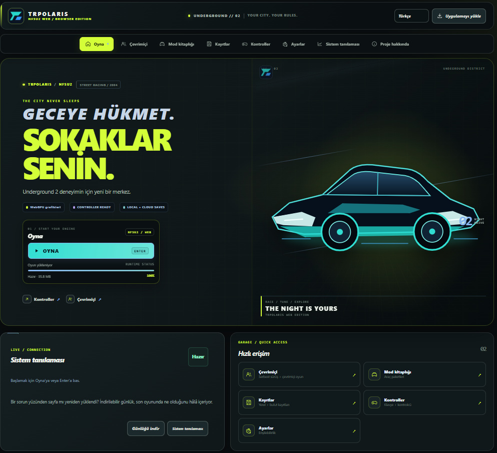
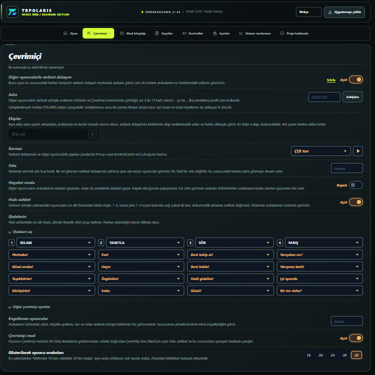
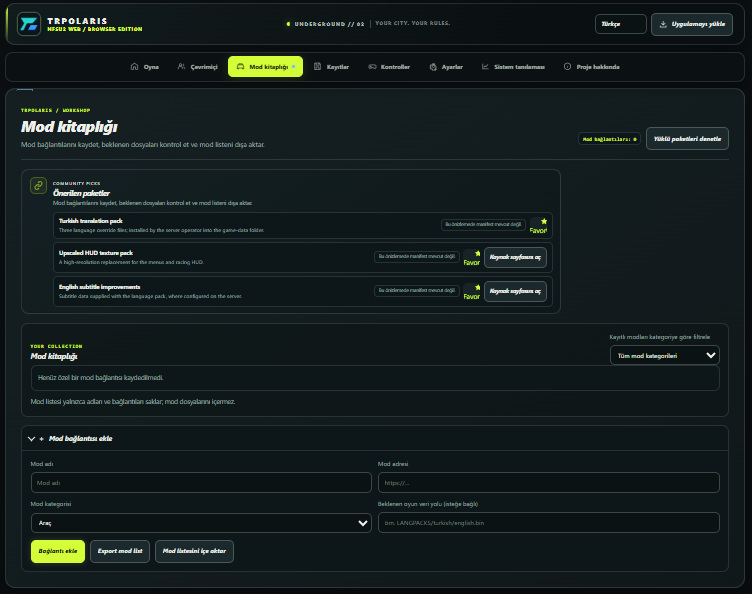
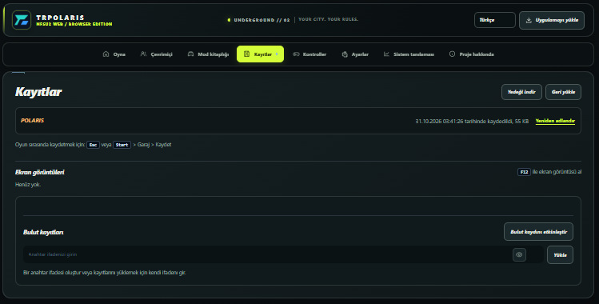
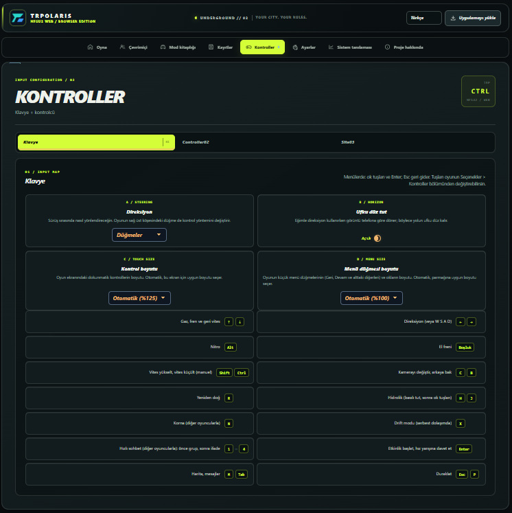
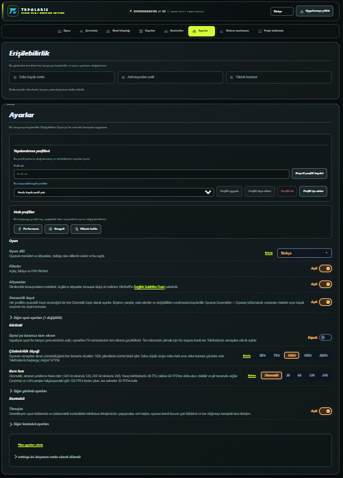
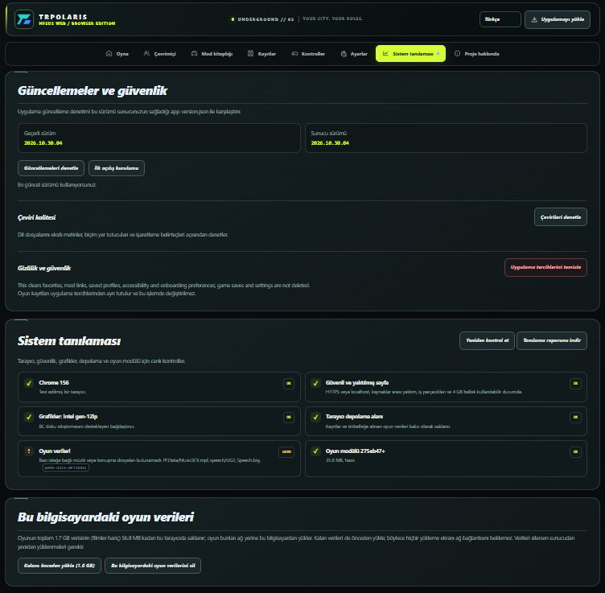
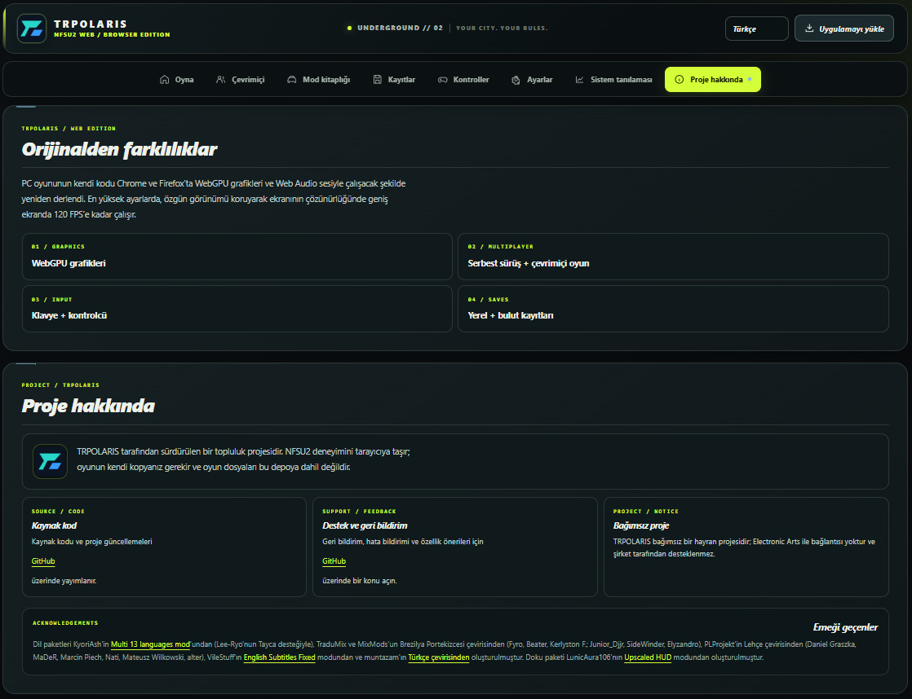
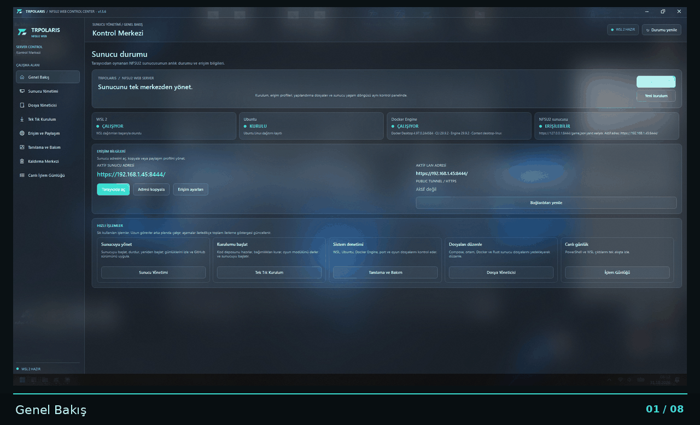

<div align="center">

# TRPOLARIS · Need for Speed: Underground 2 Web

**NFSU2 deneyimini WebAssembly, WebGPU ve modern web teknolojileriyle tarayıcıya taşıyan topluluk projesi.**

[](https://github.com/trpolaris)
[](LICENSE)
[](https://github.com/trpolaris/NFSU2-Web/actions/workflows/multiplayer-ci.yml)
[](https://github.com/trpolaris/NFSU2-Web/actions/workflows/image-rs.yml)
[](https://webassembly.org/)
[](https://developer.mozilla.org/docs/Web/API/WebGPU_API)
[](https://www.rust-lang.org/)

[Proje](#proje-hakkında) · [Ekran Görüntüleri](#ekran-görüntüleri) · [NFSU2 Web](#nfsu2-web) · [Player Hub](#trpolaris-player-hub) · [Mimari](#sistem-mimarisi) · [Kurulum](#kurulum) · [Geliştirme](#geliştirme-ve-testler) · [Lisans](#lisans-ve-atıflar)

</div>

---

## Proje hakkında

**TRPOLARIS NFSU2 Web**, *Need for Speed: Underground 2* PC sürümünü tarayıcıda çalıştırmayı hedefleyen bağımsız bir topluluk projesidir. Oyunun kullanıcıya ait PC dosyalarından üretilen WebAssembly modülü tarayıcıda çalışır; WebGPU grafik tarafını, Web Audio ses tarafını, Rust sunucusu ise oyun dosyalarının sunulmasını ve çok oyunculu ağ servislerini üstlenir.

Depoda birbiriyle entegre çalışan ancak ayrı amaçlara sahip üç ana parça bulunur:

| Bileşen | Platform | Görevi |
|---|---|---|
| **NFSU2 Web** | Web tarayıcısı + Linux/WSL sunucusu | Oyunu tarayıcıda çalıştırır; yerel oyun, çevrimiçi servisler ve Free Roam deneyimini sunar. |
| **TRPOLARIS Player Hub** | React web uygulaması | Oyuncu özeti, canlı oyuncu listesi, özel profil ve kullanıcı tarafından oluşturulan garaj kayıtlarını sunar. |
| **TRPOLARIS Control Center** | Windows / WPF / .NET 10 | WSL, Ubuntu ve Docker üzerinden web sunucusunun kurulumunu ve yönetimini kolaylaştırır. |

Oyunun ana arayüzü `/` adresinde, Player Hub ise aynı sunucuda `/hub/` adresinde çalışır. Hub için ikinci bir backend, ayrı bir port veya ayrı bir deployment gerekmez. Windows Control Center ise web oyununun parçası olmayan bağımsız bir masaüstü uygulamasıdır.

### Projenin kaynağı ve atıf

Teknik esin kaynağı [th0mk/nfsu2-web](https://github.com/th0mk/nfsu2-web) açık kaynak projesidir. TRPOLARIS çalışması bu tarayıcı tabanlı NFSU2 yaklaşımını temel alır; kendi arayüzünü, Player Hub uygulamasını, Rust sunucu geliştirmelerini, dağıtım akışlarını, sohbet deneyimini ve Windows yönetim aracını ekler.

Orijinal projenin kaynak kodu ve katkıları kendi geliştiricilerine aittir. TRPOLARIS'e özgü eklemeler ayrı geliştirmelerdir; orijinal projenin geliştiricileri tarafından hazırlanmış veya onaylanmış olarak sunulmaz.

> [!IMPORTANT]
> Bu depo **Need for Speed: Underground 2 oyun dosyalarını içermez**. `SPEED2.EXE`, `server.dll`, oyun arşivleri, sesler, videolar veya başka telifli oyun varlıkları Git deposuna ya da Docker imajına eklenmez. Derleme ve kullanım için kendi yasal PC oyun kopyanız gerekir.

---

## Ekran görüntüleri

NFSU2 Web arayüzünün depoda bulunan ekran görüntüleri, dosyaların gerçek konumları ve adları kullanılarak aşağıda listelenmiştir.

<table>
<tr>
<td align="center"><strong>09 · Ana Sayfa</strong><br/></td>
<td align="center"><strong>10 · Çevrimiçi</strong><br/></td>
</tr>
<tr>
<td align="center"><strong>11 · Mod Kitaplığı</strong><br/></td>
<td align="center"><strong>12 · Kayıtlar</strong><br/></td>
</tr>
<tr>
<td align="center"><strong>13 · Kontroller</strong><br/></td>
<td align="center"><strong>14 · Ayarlar</strong><br/></td>
</tr>
<tr>
<td align="center"><strong>15 · Sistem Tanılaması</strong><br/></td>
<td align="center"><strong>16 · Proje Hakkında</strong><br/></td>
</tr>
</table>

> Player Hub ve oyun içi HUD ekranları için yeni görseller henüz bu depoya eklenmediğinden, bu bölümde yalnızca GitHub'da mevcut olan ekran görüntüleri gösterilir.

### Control Center

Control Center ekranları ayrı bir masaüstü uygulamasına aittir. Mevcut galeri ve ayrıntılı açıklamalar:

<p align="center">
  
</p>

| Ekran | Açıklama |
|---|---|
| [Genel Bakış](docs/screenshots/control-center/01-genel-bakis.jpg) | WSL, Ubuntu, Docker ve sunucu durumu. |
| [Sunucu Yönetimi](docs/screenshots/control-center/02-sunucu-yonetimi.jpg) | Container işlemleri, güncelleme ve günlükler. |
| [Dosya Yöneticisi](docs/screenshots/control-center/03-dosya-yoneticisi.jpg) | WSL proje dosyalarını görüntüleme ve düzenleme. |
| [Tek Tık Kurulum](docs/screenshots/control-center/04-tek-tik-kurulum.jpg) | Oyun klasörü ve port seçimiyle kurulum. |
| [Erişim ve Paylaşım](docs/screenshots/control-center/05-erisim-ve-paylasim.jpg) | Yerel, LAN/HTTPS ve tünel profilleri. |
| [Tanılama ve Bakım](docs/screenshots/control-center/06-tanilama-ve-bakim.jpg) | WSL, Docker, port ve sunucu kontrolleri. |
| [Kaldırma Merkezi](docs/screenshots/control-center/07-kaldirma-merkezi.jpg) | NFSU2 bileşenlerini seçerek kaldırma. |
| [Canlı İşlem Günlüğü](docs/screenshots/control-center/08-canli-islem-gunlugu.jpg) | PowerShell ve WSL işlemlerini izleme. |

---

---

## NFSU2 Web

NFSU2 Web, oyunun PC kodunu önceden derlenmiş ve depoya eklenmiş bir hazır oyun dosyası olarak dağıtmaz. Kullanıcının oyun kopyasından kod üretir, bu kodu WASM modülüne dönüştürür ve tarayıcıya sunar.

### Oyun ve tarayıcı özellikleri

- **WebAssembly çalışma zamanı:** PC oyununun kaldırılmış kodu ve web uyumluluk katmanı `wasm32-wasip1-threads` hedefi için derlenir.
- **WebGPU grafikleri:** Tarayıcının GPU API'si üzerinden oyun görüntüsü oluşturulur. Destek; tarayıcı, işletim sistemi, GPU ve sürücüye bağlıdır.
- **Web Audio:** Oyun sesleri tarayıcıdaki ses katmanından yürütülür.
- **İşçi süreçleri (Workers):** Oyun, giriş/çıkış ve ön indirme işleri ayrı worker modüllerine dağıtılır.
- **Giriş aygıtları:** Klavye, fare, uyumlu gamepad ve desteklenen dokunmatik kontroller. Dokunmatik ekranda direksiyon düğmeleri, sanal joystick veya eğim kontrolü gibi seçenekler bulunur.
- **Yerel kayıtlar:** Tarayıcıya ait OPFS alanında saklanan kayıtlar ve oyun ayarları.
- **Çok oyunculu:** Rust sunucusu üzerinden sanal LAN, Free Roam ve oyunun Online servis akışları.
- **PWA / çevrimdışı başlatma:** Service Worker sayfa ve oyun modülünün sürümlü kopyalarını tutar; gerekli oyun verileri önceden indirilmişse tek oyunculu kullanım ağ kesintisinde de devam edebilir.
- **Çok dilli arayüz:** İngilizce, Fransızca, Almanca, İtalyanca, İspanyolca, Felemenkçe, İsveççe, Danca, Korece, Geleneksel Çince, Japonca, Rusça, Tayca, Brezilya Portekizcesi, Lehçe ve Türkçe.

En güncel Google Chrome önerilir. Proje ayrıca Firefox ve desteklenen iPhone/iPad Safari sürümlerini hedefler. WebGPU ve güvenli tarayıcı özellikleri cihaz bazında değişebileceğinden, uygulama başlamadan önce **Sistem Tanılaması** ekranındaki kontrolleri çalıştırır.

### Ana sayfa ve oyun akışı

Ana sayfa tarayıcıyı, güvenli bağlamı, grafik desteğini, depolamayı, oyun dosyalarını ve oyun modülünü kontrol eder. Kontroller tamamlandığında oyun modülü yüklenir ve ilerleme durumu gösterilir. Oyuncu **Oyna** düğmesi veya Enter ile oyuna geçer.

`F8` tanılama katmanı FPS ve ağ metriklerini gösterebilir. Buradaki RTT, oyuncular arası doğrudan ping değil, istemci ile sanal LAN sunucusu arasındaki WebSocket gidiş-dönüş süresidir. Daha fazla bilgi: [Ağ Tanılama Rehberi](docs/web/NETWORK-DIAGNOSTICS.md).

### Oyun içi kontrol menüsü — F9

Oyun çalışırken `F9`, TRPOLARIS oyun içi kontrol menüsünü açar. Menü aşağıdaki alanları bir araya getirir:

- **Chat HUD:** Sohbet paneli boyutu, arka plan opaklığı ve ekrandaki konum.
- **Game Session:** Aktif oyun oturumuna ait kontroller.
- **Driver / Online:** Oyuncu ve çevrimiçi durum bilgileri.
- **Radio / Music:** Radyo ve müzik alanı.
- **Career Data:** Kariyer verisi bölümü.

Gösterilen alanlar, oyun çalışma zamanının sağladığı verilerle sınırlıdır. Player Hub'daki istatistik durumu için ayrıca [Player Hub veri sınırları](#player-hub-veri-kapsamı) bölümüne bakın.

### Free Roam sohbeti

Free Roam sohbet sistemi, oyun içi HUD üzerinde hızlı ifadeleri ve yazılı mesajlaşmayı bir araya getirir.

- Yazılı sohbet filtreleri: tüm mesajlar, herkes/oda, ekip sohbeti ve sistem mesajları.
- Mesaj arama alanı, kanal değiştirme ve isteğe bağlı etiket/mention bildirimi sesi.
- Oyuncu adları için kararlı renk ataması; kendi mesajları ayrıca ayırt edilir.
- Hızlı ifadeler: `Solundayım!`, `GG!` ve `Sorry!` gibi hazır mesajlar.
- Sohbet kapalıyken mesajlar görsel olarak solar; geçmiş oturum içinde tutulur. Sohbet tekrar açıldığında okunabilir.
- Sohbet geçmişi en fazla **200 satır** tutar; oturum bittiğinde temizlenir.
- Sunucu, yazılı sohbeti oyuncu başına kayan 5 saniyelik pencerede en fazla **4 kabul edilen mesaj** ile sınırlar.

`Y` sohbeti açar; yazı alanında Enter mesaj gönderir; Tab kanal değiştirir; Esc kapatır. Hızlı ifade seçimi için oyundaki yönlendirmeler ve `1–4` tuş grupları kullanılır. Ayrıntılar: [Free Roam Sohbet Rehberi](docs/web/FREEROAM-CHAT.md).

### Mod Kitaplığı

Mod Kitaplığı, topluluk tarafından önerilen paketleri ve oyuncunun kendi mod bağlantılarını düzenli biçimde saklar. Türkçe çeviri paketi, HUD/texture paketi veya altyazı iyileştirmeleri gibi kaynaklara bağlantı verebilir.

> Mod Kitaplığı **mod dosyalarını barındırmaz veya otomatik kurmaz**. Kişisel liste esas olarak adları, kategorileri ve bağlantıları tutar. Dosyaların kaynağını, sürümünü ve oyun kopyanızla uyumluluğunu kendiniz doğrulamalısınız.

### Kayıtlar ve TRPOLARIS Cloud

- Yerel oyun profilleri tarayıcıda tutulur; kullanıcı yedek alabilir ve kayıtlarını geri yükleyebilir.
- Oyun sırasında `F12` ekran görüntüsü alma kısayoludur.
- Bulut eşitleme, sunucunun aynı origin üzerindeki **TRPOLARIS Cloud v1** servisini kullanır.
- Bulut kaydı için e-posta hesabı değil, sekiz kelimelik bir anahtar ifade kullanılır. Tarayıcı kayıt arşivini cihaz üzerinde PBKDF2/AES-GCM ile şifreler; sunucu yalnızca şifreli içeriği ve anahtar ifadenin türetilmiş kimliğinin hash'ini saklar.
- Yeni istemci uç noktaları `GET/PUT/DELETE /cloud/v1/saves` biçimindedir. ETag / koşullu yazma, iki tarayıcının birbirinin verisini sessizce ezmesini önler.
- Sunucu son kaydı ve önceki UTC gününden kurtarma kopyasını saklar. Tek snapshot için sınır 256 KiB'dir.
- Eski `/vault` endpoint'i mevcut kayıtlarla geriye dönük uyumluluk için korunur.

Bulut kayıtlarının çalışması için sunucu state alanı kalıcı olmalıdır. Docker ortamında `docker compose down -v` komutu state volume'unu da silebilir; kayıtları korumak istiyorsanız bu komutu kullanmayın. Teknik ayrıntılar: [TRPOLARIS Cloud Rehberi](docs/web/TRPOLARIS-CLOUD.md).

### Ayarlar ve erişilebilirlik

Ayarlar ekranı oyun tercihlerini tarayıcıdaki `settings.ini` karşılığı üzerinden yönetir. Dil, ses, video, altyazı, arka planda çalışma, çözünürlük ölçeği, FPS seçimi, gamepad davranışı, titreşim, ölü bölgeler ve dokunmatik kontroller gibi seçenekler ilgili cihaz ve tarayıcı tarafından desteklendiği ölçüde uygulanır.

Kontroller ekranında klavye ve gamepad eşlemeleri; dokunmatik cihazlarda kontrol boyutu ve menü düğmesi boyutu gibi ayarlar bulunur. Tercihler tarayıcı profiline göre saklanır.

### Veri sınırları ve güvenli dosya sunumu

Sunucu, oyun klasörünün tamamını web'e açmaz. `/data-manifest` yalnızca oyunun çalışması için izin verilen oyun dosyalarını listeler. Kurulum günlükleri, kaldırma dosyaları, kullanıcı kayıt klasörleri, mod scriptleri, yedekler, notlar, gizli dosyalar ve izin verilmeyen klasörler sunulmaz. Docker dağıtımında oyun klasörü `/game` olarak salt okunur bağlanır.

---

## TRPOLARIS Player Hub

Player Hub, ana oyun sayfasından ayrı bir React uygulamasıdır. `/hub/` yolunda açılır; aynı Rust sürecini ve aynı origin'i kullanır. Oyun DOM ağacını React'e taşımaz ve oyun çalışma zamanını yeniden yazmaz.

### Sayfalar ve işlevler

| Sayfa | İşlev |
|---|---|
| **Genel Bakış** | Canlı oyuncu sayısı, Free Roam/Online özeti, profil özeti ve garaj sayısı. |
| **Çevrimiçi** | Rust sunucusunun aktif oyuncu listesini ve mevcut etkinlik durumunu görüntüler. Liste yenilenebilir. |
| **Profilim** | Görünen ad, kısa biyografi ve favori araç etiketini düzenler. |
| **Garajım** | Marka, model, yıl ve not alanlarıyla kullanıcı tarafından eklenen araç kayıtlarını tutar. |
| **İstatistikler** | Kariyer telemetrisi için ayrılmış alan; gerçek oyun verisi bağlanana kadar yer tutucu olarak gösterilir. |

### API ve güvenlik

Player Hub'ın React istemcisi aşağıdaki aynı-origin API uç noktalarını kullanır:

| Endpoint | Metot | Açıklama |
|---|---|---|
| `/api/v1/session` | GET | Anonim tarayıcı oturumu oluşturur veya sürdürür; CSRF token döndürür. |
| `/api/v1/live/players` | GET | Gerçek switch kayıtlarından canlı oyuncu listesini döndürür. |
| `/api/v1/me` | GET / PUT | Geçerli tarayıcı oturumunun profilini okur veya günceller. |
| `/api/v1/garage` | GET / POST | Geçerli oturumun garaj kayıtlarını listeler veya yeni araç ekler. |
| `/api/v1/garage/:id` | DELETE | Oturum sahibine ait tek bir garaj kaydını siler. |

Güvenlik katmanı; host-only `HttpOnly`, `Secure`, `SameSite=Strict` oturum çerezi, sunucuda token hash'i, `X-TRP-CSRF` başlığı, aynı-origin kontrolü ve sınırlandırılmış istek gövdesi kullanır. Profil ve garaj verileri sunucunun mevcut `/state` alanındaki `player-hub.json` dosyasına atomik yazımla kaydedilir; dosya izinleri kısıtlıdır.

Canlı oyuncu API'si herkese açık listede sanal IP, gerçek istemci IP'si, tarayıcı kimliği veya claim token döndürmez.

### Player Hub veri kapsamı

İlk sürümün veri sınırları özellikle nettir:

- Profil, anonim tarayıcı oturumuna özeldir; henüz e-posta/şifre hesabı veya cihazlar arası kalıcı kimlik sistemi yoktur.
- Garaj kayıtları oyuncunun elle girdiği bilgilerdir. Oyunun gerçek save dosyasından araç envanteri veya modifiye parçalar otomatik okunmaz.
- Kariyer galibiyetleri, para, yarış geçmişi, en iyi süreler ve benzeri istatistikler henüz WASM çalışma zamanından sunucuya telemetri olarak aktarılmaz. Bu nedenle ekran gerçek veri varmış gibi davranmaz; entegrasyon bekleyen alanları yer tutucu olarak gösterir.

---

## Sistem mimarisi

```text
                       ┌─────────────────────────────┐
                       │        Web Browser          │
                       │                             │
                       │  /            /hub/          │
                       │  TypeScript   React Hub      │
                       │      │          │            │
                       │   WASM Host   Hub API Client │
                       │   WebGPU      React/Motion   │
                       │   Web Audio   Lucide         │
                       └──────┬───────────┬───────────┘
                              │ HTTP      │ REST
                              │ WebSocket │
                       ┌──────▼───────────▼───────────┐
                       │        Rust Server          │
                       │                              │
                       │ HTTP/TLS · Security · Cache  │
                       │ LAN Switch · Online · Roam   │
                       │ Cloud Saves · Player Hub     │
                       └──────┬───────────┬───────────┘
                              │           │
                    ┌─────────▼──┐   ┌────▼──────────┐
                    │ /game data │   │ Persistent    │
                    │ /module    │   │ /state        │
                    └────────────┘   └───────────────┘
```

### Web istemcisi

- **TypeScript:** Ana oyun sayfası, arayüz, ayarlar, kayıt yönetimi, giriş aygıtları, ağ istemcisi ve oyun yaşam döngüsü.
- **C / kaldırılmış oyun kodu:** Kullanıcıya ait `SPEED2.EXE` ve mevcutsa `server.dll` dosyalarından üretilen kod.
- **WASM host:** Worker modülleri, WASI uyumluluk katmanı, modül belleği ve tarayıcı ile oyun arasındaki köprü.
- **WebGPU / Web Audio:** Grafik ve ses çıkış katmanları.
- **Service Worker + OPFS:** Sürümlü sayfa/modül önbelleği ve tarayıcıya özel oyun verileri.

### Player Hub ön yüzü

React uygulaması `web/src/hub/` altında yer alır. Derleme `web/build.mjs` ile yapılır; oyun ve Hub dosyaları aynı web dağıtımına çıkar. Kullanılan temel paketler:

- React / React DOM 19.3.1
- Motion 14.9.0
- Lucide React 1.66.0
- Tailwind CSS 4.3.3 (Preflight reset'i kapalı, mevcut oyun kontrollerini sıfırlamaz)
- esbuild (tek web build akışı)

Paketler derleme sırasında bundle edilir; tarayıcıda çalışırken üçüncü taraf CDN'den React, ikon veya font indirilmesi gerekmez.

### Rust backend

Sunucu Rust 2024 edition workspace olarak `web/server-rs/` altında geliştirilir. Tokio çok iş parçacıklı çalışma zamanını; rustls TLS'i; özel HTTP ve WebSocket katmanları ağ protokollerini yürütür.

| Modül / crate | Sorumluluk |
|---|---|
| `nfsu2-http` | HTTP/1.1 istekleri, bağlantı yönetimi ve TLS entegrasyonu. |
| `nfsu2-ws` | WebSocket handshake ve frame işleme. |
| `nfsu2-lan` | Sanal LAN switch'i, oyuncu adresleri, paket yönlendirme ve bağlantı yaşam döngüsü. |
| `nfsu2-roam` | Free Roam hub'ı, yakın oyuncu bağlantıları, konvoy/ekip işaretleri ve durum güncellemeleri. |
| `nfsu2-online` | Oyunun Online lobby, oturum, mesaj ve yarış akışları. |
| `nfsu2-vault` | Şifreli bulut kayıtlarının sunucu tarafı saklama motoru. |
| `nfsu2-claims` / `nfsu2-bans` | İsim sahipliği ve operatör ban kayıtları. |
| `nfsu2-names` / `nfsu2-headers` / `nfsu2-util` | İsim temizleme, güvenlik başlıkları, limitler, yardımcı fonksiyonlar ve ortak kurallar. |
| `nfsu2-server` | HTTP rotaları, yapılandırma, servislerin birleştirilmesi ve ana sunucu binary'si. |
| `nfsu2-roamload` | Free Roam yük testleri için simüle oyuncu üreticisi. |

### Sunucu veri alanları

Docker dağıtımında bileşenler ayrı bağlanır:

| Yol | İçerik | Yazma davranışı |
|---|---|---|
| `/game` | Kullanıcının NFSU2 kurulum klasörü | Salt okunur |
| `/module` | `nfsu2.wasm` ve `nfsu2.json` | Salt okunur |
| `/state` | ETag anahtarları, LAN/Online durum kayıtları, ban/claim kayıtları, Cloud ve Player Hub verileri | Kalıcı yazılabilir volume |

Güncelleme sırasında `/state` korunmalıdır. Sunucu imajı oyunun telifli verilerini içermez.

---

## Gereksinimler

### Oyun dosyaları

Proje belgelerinde hedeflenen sürüm **Need for Speed: Underground 2 v1.2 North America** PC sürümüdür.

| Dosya | Beklenen değer |
|---|---|
| `SPEED2.EXE` | 4.800.512 bayt |
| SHA-256 | `f9dd86c054878ce6276beb07c1fd61874f7a1e4bf1f241b084c65b73e24168a7` |

`server.dll` ve `server.cfg` mevcut oyun kurulumunuzdan kullanılır. Oyunun orijinal dosyaları GitHub'a yüklenmemelidir.

### Derleme araçları

- 64-bit Linux veya WSL2 Ubuntu ortamı.
- Git.
- Python 3, `venv` ve pip.
- `requirements.txt` içindeki `capstone` ve `pefile` paketleri.
- Node.js 24 ve npm.
- Rust stable toolchain (workspace en az Rust 1.85 / edition 2024 gerektirir).
- WASI SDK 34 (Linux x86_64 için uygun paket; `clang` ve `wasm-ld` içerir).
- Rust native bağımlılıkları için C derleyicisi ve sistem build araçları.

Derleme çıktıları `gen/`, `out/`, `deps/` ve `.venv/` altında tutulur; bunlar `.gitignore` kapsamındadır ve Git'e eklenmemelidir.

---

## Kurulum

### A. Linux / WSL üzerinde yerel geliştirme

Aşağıdaki akış, kendi oyun klasörünüzden WebAssembly modülü üretir ve Rust sunucusunu yerel olarak başlatır.

**1. Depoyu klonlayın ve Python ortamını hazırlayın.**

```bash
git clone https://github.com/trpolaris/NFSU2-Web.git
cd NFSU2-Web

python3 -m venv .venv
source .venv/bin/activate
python -m pip install --upgrade pip
python -m pip install -r requirements.txt
```

**2. WASI SDK 34'ü `deps/` içine yerleştirin.**

WASI SDK 34 Linux x86_64 paketini [WASI SDK Releases](https://github.com/WebAssembly/wasi-sdk/releases) sayfasından indirin ve depo kökünde şu yapıda açın:

```text
deps/
└── wasi-sdk-34.0-x86_64-linux/
    └── bin/
        ├── clang
        └── wasm-ld
```

**3. Kendi NFSU2 oyun klasörünüzü tanımlayın.**

`NFSU2_DATA`, içinde `SPEED2.EXE` bulunan klasörü göstermelidir. WSL örneği:

```bash
export NFSU2_DATA="/path/to/Need for Speed Underground 2"
```

**4. Oyun kodunu üretin ve WASM modülünü derleyin.**

```bash
bash web/gen.sh "$NFSU2_DATA/SPEED2.EXE"

export WASI="$PWD/deps/wasi-sdk-34.0-x86_64-linux"
WASI="$WASI" J="$(nproc)" bash web/build.sh
```

`web/gen.sh`, `SPEED2.EXE` ve oyun klasöründeki desteklenen sunucu modülünü işler; üretilen C kaynakları `gen/all/` ve `gen/server/` altına yazılır. `web/build.sh`, bu kodu runtime katmanıyla birleştirerek aşağıdaki çıktıları üretir:

```text
out/web/nfsu2.wasm
out/web/nfsu2.json
```

**5. Web arayüzünü kontrol edin ve derleyin.**

```bash
cd web
npm ci
npm run check
npm run build
cd ..
```

**6. Rust sunucusunu derleyin ve testlerini çalıştırın.**

```bash
bash web/server-rs/build.sh
bash web/server-rs/build.sh --test
```

Derleme çıktıları:

```text
out/web/server-rs/nfsu2-server
out/web/server-rs/nfsu2-roamload
```

**7. Yerel sunucuyu başlatın.**

```bash
bash web/start.sh --data "$NFSU2_DATA"
```

Varsayılan yerel adres:

```text
http://localhost:8080/
```

Sunucuyu durdurmak için `Ctrl+C` kullanın. Port doluysa farklı port verebilirsiniz:

```bash
bash web/start.sh --data "$NFSU2_DATA" --http-port 9080
```

`web/start.sh`, eksik veya kaynaklardan eski olan sayfa ve Rust sunucu çıktısını kontrol eder. WebAssembly modülünü yeniden derlemesi gerektiğinde `deps/` içinde WASI SDK ve `gen/all/` kaynaklarını arar. Bir derleme başarısız olursa eski/eksik çıktı ile sunucuyu başlatmak yerine hata verir.

### B. Başka bilgisayarlardan erişim

Tarayıcı oyun çalışma zamanı güvenli bağlam ister. `localhost` yerel geliştirme için uygundur; LAN'daki diğer cihazlar veya internet oyuncuları için HTTPS gerekir. Yerel HTTP portunu doğrudan internete açmak yerine Caddy, Nginx veya Cloudflare Tunnel gibi doğru WebSocket geçişini destekleyen bir reverse proxy kullanın.

### C. VPS üzerinde Docker Compose

Depoda hazır Docker dağıtım dosyaları bulunur:

- Compose: `web/deploy/compose.yml`
- Caddy yapılandırması: `web/deploy/Caddyfile`
- Sunucu imajı: `web/server-rs/Dockerfile`
- Ayrıntılı adımlar: [VPS Kurulum Rehberi](docs/web/VPS.md)

Temel düzen:

1. VPS üzerinde `/srv/nfsu2/game` ve `/srv/nfsu2/module` klasörlerini oluşturun.
2. Kendi oyun dosyalarınızı `/srv/nfsu2/game` içine; `out/web/nfsu2.wasm` ve `out/web/nfsu2.json` dosyalarını `/srv/nfsu2/module` içine aktarın.
3. `web/deploy/compose.yml` dosyasını `/srv/nfsu2/` içine kopyalayın.
4. Aynı dizinde `.env` dosyası oluşturun:

```dotenv
NFSU2_HOST=game.example.com
NFSU2_DATA=/srv/nfsu2/game
NFSU2_MODULE=/srv/nfsu2/module
NFSU2_IMAGE=ghcr.io/trpolaris/need-for-speed-underground-2-web-rs:latest
```

5. DNS A/AAAA kayıtlarını VPS'e yönlendirin; güvenlik duvarında gerekli HTTP/HTTPS portlarını açın.
6. Servisleri başlatıp günlükleri kontrol edin:

```bash
cd /srv/nfsu2
docker compose up -d
docker compose logs -f server
```

Compose yapılandırması Caddy ile TLS sertifikasını alıp yenileyebilir. Port 80/443 kullanım durumuna, Cloudflare tercihine ve mevcut reverse proxy topolojinize göre `compose.443.yml`, `compose.cloudflare.yml`, `compose.origin.yml` veya `compose.tunnel.yml` varyantlarını değerlendirin.

> [!WARNING]
> Sunucu varsayılan olarak kullanıcı hesabı/parola tabanlı bir genel erişim sistemi sunmaz. İnternet üzerinden herkese açık kullanımda Cloudflare Access veya eşdeğer bir erişim politikası kurun. Mevcut Docker state volume'unu silmeyin; aksi halde oyuncu kayıtları, anahtarlar ve sunucu durumu kaybolabilir.

---

## TRPOLARIS Control Center

Control Center, Windows üzerinden WSL2, Ubuntu ve Docker işlemlerini yönetmek için hazırlanmış bağımsız WPF/.NET 10 uygulamasıdır. NFSU2 Web'in yerine geçmez; web sunucusunu kurma ve yönetme sürecini kolaylaştırır.

### Özellikler

- Tek tıkla kurulum ve bağımlılık kontrolü.
- Sunucuyu başlatma, durdurma, yeniden başlatma ve sağlık durumunu görüntüleme.
- WSL proje dosyaları için dosya yöneticisi.
- Local, LAN/HTTPS ve isteğe bağlı Cloudflare Tunnel erişim profilleri.
- WSL, Ubuntu, Docker, port ve sunucu tanılaması.
- Canlı işlem günlükleri ve ilerleme durumu.
- NFSU2 bileşenlerini seçerek kaldırma.

### Gereksinimler ve indirme

- Windows 10/11 x64.
- WSL 2 ve Ubuntu dağıtımı.
- Docker Engine (Docker Desktop veya uygun WSL Docker kurulumu).
- Kurulum ve bağımlılıklar için internet bağlantısı.
- WebAssembly üretimi için kullanıcıya ait NFSU2 PC oyun kopyası.

**[Control Center sürümleri ve indirmeler](https://github.com/trpolaris/NFSU2-Web/releases)** · [Kaynak kodu](control-center/) · [Ayrıntılı kullanım rehberi](control-center/README.md)

Kaldırma öncesinde oyun kayıtlarını ve önemli dosyaları yedekleyin. Ubuntu WSL dağıtımını veya Docker volume'larını kaldırmak diğer projeleri ve kalıcı verileri de silebilir.

---

## Geliştirme ve testler

### Depo yapısı

| Yol | İçerik |
|---|---|
| `app/` | Oyun ve proje için ortak registry/default verileri. |
| `runtime/` | Oyunun C çalışma zamanı, platform uyumluluk katmanı ve web host entegrasyonu. |
| `gen/` | Oyun EXE/DLL dosyalarından üretilen C kodu; yerel üretilir, Git'e eklenmez. |
| `out/` | WASM, Rust binary'leri, derleme cache'i ve test çıktıları; Git'e eklenmez. |
| `deps/` | WASI SDK ve yerel build bağımlılıkları; Git'e eklenmez. |
| `.venv/` | Python sanal ortamı; Git'e eklenmez. |
| `web/src/app/` | Ana oyun arayüzü, ayarlar, kayıtlar, giriş ve sohbet modülleri. |
| `web/src/host/`, `web/src/gpu/`, `web/src/audio/` | WASM worker/host, grafik ve ses katmanları. |
| `web/src/hub/` | React Player Hub uygulaması ve stilleri. |
| `web/server-rs/` | Rust sunucusu, crate'ler, Dockerfile ve testler. |
| `web/deploy/` | Docker Compose, Caddy ve dağıtım dosyaları. |
| `web/tools/` | Derleme yardımcıları, test araçları, sunucu ve multiplayer test sürücüleri. |
| `web/test/` | Web, güvenlik, veri, UI, multiplayer ve entegrasyon testleri. |
| `docs/web/` | Oynama, VPS, ağ tanılama, Cloud, sohbet ve mimari belgeleri. |
| `docs/screenshots/` | README ve proje belgelerinde kullanılan ekran görüntüleri. |
| `control-center/` | Bağımsız Windows WPF/.NET 10 uygulaması. |
| `.github/workflows/` | Multiplayer/regresyon CI ve container image workflow'ları. |

### Kontrol komutları

Web TypeScript kontrolü ve derlemesi:

```bash
cd web
npm ci
npm run check
npm run build
cd ..
```

Rust workspace testleri:

```bash
bash web/server-rs/build.sh --test
```

Web testleri:

```bash
node --test --test-concurrency=1 web/test/*.test.mjs
```

CI ayrıca Rust server binary'lerini derler, sentetik Online protokol load/abuse smoke testini çalıştırır, Chromium kurar ve web regresyon paketini çalıştırır. `image-rs` workflow'u Docker container imajını build eder. Durumlar:

- [Multiplayer and Regression CI](https://github.com/trpolaris/NFSU2-Web/actions/workflows/multiplayer-ci.yml)
- [Container Image CI](https://github.com/trpolaris/NFSU2-Web/actions/workflows/image-rs.yml)

### İlgili teknik belgeler

- [Oynama Rehberi](docs/web/PLAYING.md)
- [VPS ve Docker Kurulumu](docs/web/VPS.md)
- [Ağ Tanılama](docs/web/NETWORK-DIAGNOSTICS.md)
- [Free Roam Sohbeti](docs/web/FREEROAM-CHAT.md)
- [TRPOLARIS Cloud](docs/web/TRPOLARIS-CLOUD.md)
- [Web Tasarım Sistemi ve Player Hub Mimarisi](docs/web/WEB-UX-DESIGN-SYSTEM.md)
- [Web Tasarım / Oyun Mimarisi](docs/web/DESIGN.md)
- [Rust Sunucu Rehberi](web/server-rs/README.md)
- [Control Center Rehberi](control-center/README.md)

---

## Bilinen kapsam ve sınırlamalar

- Player Hub profilleri henüz e-posta/şifre hesabına veya cihazlar arası ortak kimliğe bağlı değildir; anonim tarayıcı oturumuna özeldir.
- Player Hub garajı manuel kullanıcı girişidir; NFSU2 save içindeki gerçek araç envanterini otomatik içe aktarmaz.
- Kariyer istatistikleri, yarış sonuçları ve en iyi süreler için sürüm kontrollü bir oyun telemetrisi köprüsü gereklidir. Bu entegrasyon tamamlanana kadar istatistikler yer tutucu olarak gösterilir.
- Mod Kitaplığı bağlantı ve liste yönetimi sunar; mod dosyalarını depolamaz veya otomatik kurmaz.
- Çevrimdışı tek oyunculu açılış için sayfanın daha önce açılmış ve gerekli oyun verilerinin önceden indirilmiş olması gerekir. Free Roam ve Online sunucu bağlantısı gerektirir.
- WebGPU, ses ve gamepad yetenekleri tarayıcı ve donanıma bağlıdır; cihazın Sistem Tanılaması sonuçları esas alınmalıdır.

---

## Lisans ve atıflar

Kaynak kodunun lisans koşulları için [LICENSE](LICENSE) dosyasına bakın. MIT lisansı, Need for Speed: Underground 2 oyununu veya Electronic Arts'a ait oyun varlıklarını kapsamaz.

Need for Speed ve Need for Speed: Underground 2, Electronic Arts'ın ticari markalarıdır. **TRPOLARIS, Electronic Arts ile bağlantılı değildir; EA tarafından desteklenmez veya onaylanmaz.**

Teknik esin kaynağı: [th0mk/nfsu2-web](https://github.com/th0mk/nfsu2-web). Orijinal projenin kaynak kodu ve katkıları kendi sahiplerine aittir. TRPOLARIS'e ait ek arayüz, Player Hub, sunucu entegrasyonu, dağıtım ve yönetim çalışmaları bu depoda ayrı olarak geliştirilir.

---

<div align="center">

**TRPOLARIS**  
*Underground 2 · Your city, your rules.*

[⬆ README'nin başına dön](#trpolaris--need-for-speed-underground-2-web)

</div>