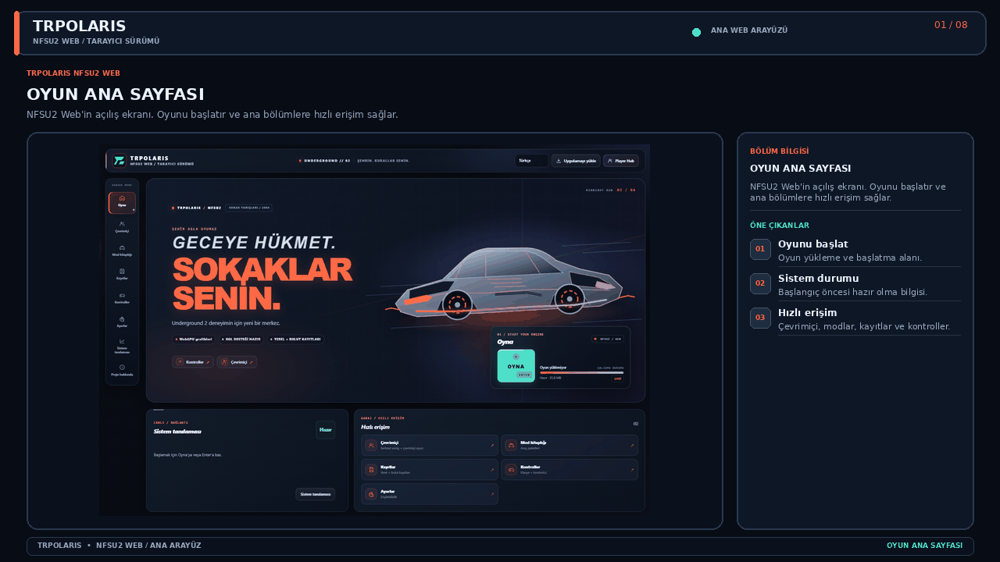
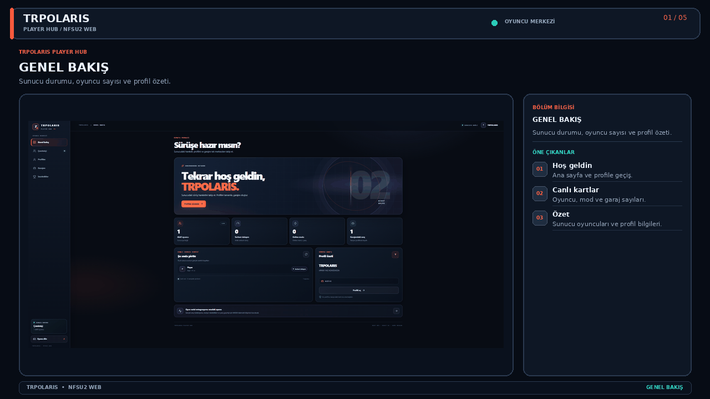
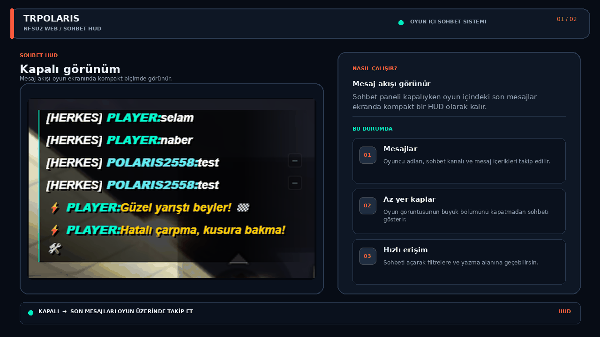
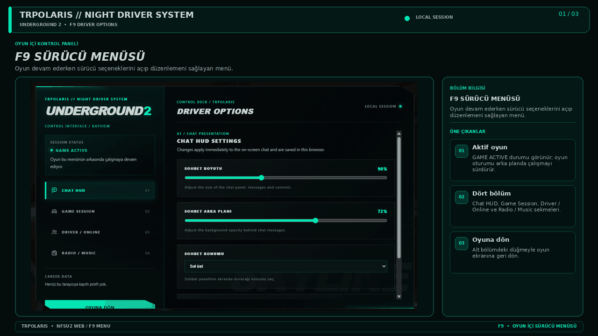
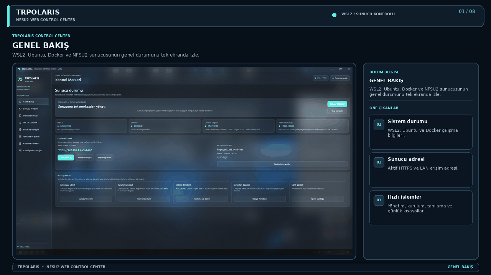
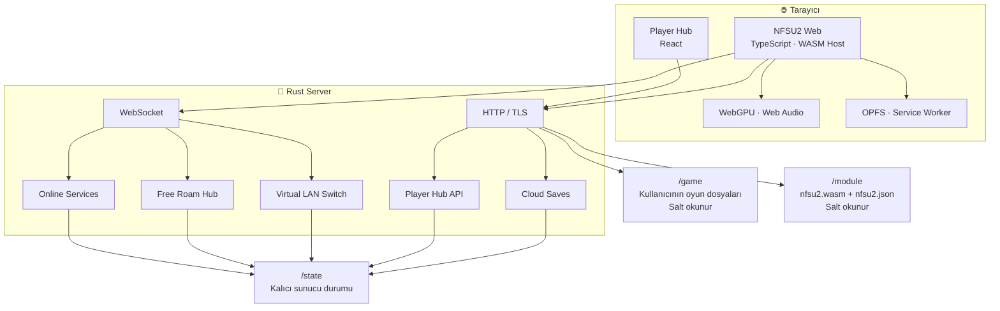

<div align="center">

# 🏁 TRPOLARIS
## Need for Speed: Underground 2 · Web Edition

**Underground 2 deneyimini WebAssembly, WebGPU ve modern web teknolojileriyle tarayıcıya taşıyan bağımsız topluluk projesi.**

<p>
  <a href="https://github.com/trpolaris/NFSU2-Web/actions/workflows/multiplayer-ci.yml"></a>
  <a href="https://github.com/trpolaris/NFSU2-Web/actions/workflows/image-rs.yml"></a>
  <a href="LICENSE"></a>
  <a href="https://webassembly.org/"></a>
  <a href="https://developer.mozilla.org/docs/Web/API/WebGPU_API"></a>
  <a href="https://www.rust-lang.org/"></a>
  <a href="https://github.com/trpolaris/NFSU2-Web/releases"></a>
</p>

<sub>README üstündeki CI rozetleri `main` dalını izler; açık PR'ların exact-HEAD durumu için GitHub Actions bağlantılarını kullanın.</sub>

[🎮 Özellikler](#-nfsu2-web) · [🖥️ Kontrol Merkezi](#️-trpolaris-control-center) · [🧭 Player Hub](#-trpolaris-player-hub) · [🏗️ Mimari](#️-sistem-mimarisi) · [⚙️ Kurulum](#-kurulum) · [🧪 Testler](#-geliştirme-ve-testler) · [🗺️ Geliştirme Durumu](#-geliştirme-durumu-ve-teknik-yol-haritasi) · [🔬 Upstream Karşılaştırması](docs/UPSTREAM-COMPARISON-ROADMAP.md)

**Ana dal:** `main` · **Sunucu:** Rust · **Oyun çalışma zamanı:** WebAssembly

</div>

---

## 📌 Proje hakkında

**TRPOLARIS NFSU2 Web**, *Need for Speed: Underground 2* PC sürümünü kullanıcıya ait oyun dosyalarından üretilen WebAssembly modülüyle tarayıcıda çalıştırmayı amaçlayan bağımsız bir topluluk projesidir.

Proje yalnızca oyunu tarayıcıya taşımakla kalmaz. Oyun deneyimini tamamlayan üç ayrı aracı tek bir ekosistemde bir araya getirir:

| Bileşen | Teknoloji / Platform | Sorumluluk |
|---|---|---|
| **NFSU2 Web** | React · TypeScript · WebAssembly · WebGPU · Web Audio | React tarafından yönetilen ana web sayfaları; TypeScript servis/host katmanı; WebAssembly oyun runtime'ı; yerel kayıtlar, çevrimiçi oyun ve Free Roam. |
| **TRPOLARIS Player Hub** | React · Rust API | Oyuncu profili, canlı oyuncular, kişisel garaj ve oyuncu merkezi. |
| **TRPOLARIS Control Center** | Windows · WPF · .NET 10 · WSL2 · Docker | Sunucu kurulumu, yönetimi, erişim profilleri, dosyalar ve tanılama. |

Ana oyun arayüzü `/`, Player Hub ise aynı sunucudaki `/hub/` yolunda çalışır. Player Hub ayrı bir port veya ikinci bir backend gerektirmez. Control Center ise web uygulamasından bağımsız bir Windows masaüstü aracıdır.

### ⚖️ Kaynak, telif ve oyun dosyaları

Teknik esin kaynağı [th0mk/nfsu2-web](https://github.com/th0mk/nfsu2-web) açık kaynak projesidir. TRPOLARIS bu tarayıcı tabanlı yaklaşımı temel alır; kendi web arayüzünü, Rust sunucu geliştirmelerini, Player Hub'ı, oyun içi sohbet deneyimini, dağıtım akışlarını ve Windows yönetim aracını ekler.

> [!IMPORTANT]
> Bu depo **Need for Speed: Underground 2 oyun dosyalarını içermez**. `SPEED2.EXE`, `server.dll`, oyun arşivleri, sesler, videolar veya başka telifli oyun varlıkları Git deposuna ya da Docker imajına eklenmez. Derleme ve kullanım için kendi yasal PC oyun kopyanızı sağlamanız gerekir.

---

## 🖼️ Ekran galerisi

Aşağıdaki GIF'ler arayüzleri ve kullanım akışlarını kendi bölümleri altında gösterir.

### 🌃 Ana web arayüzü

Oyun ana sayfası, çevrimiçi alanı, mod kitaplığı, kayıtlar, kontroller, ayarlar, sistem tanılaması ve proje bilgileri.

<p align="center">
  
</p>

### 🧭 Player Hub

Genel bakış, çevrimiçi oyuncular, profil, garaj ve istatistik ekranları.

<p align="center">
  
</p>

### 💬 Oyun içi sohbet HUD

Sohbet kapalıyken kompakt mesaj akışı; açıkken kanallar, arama, bildirim ve yazma araçları.

<p align="center">
  
</p>

### 🎛️ F9 sürücü menüsü

Oyun sırasında açılan sürücü seçenekleri ve Chat HUD görünüm ayarları.

<p align="center">
  
</p>

### 🖥️ Windows Control Center

WSL2, Ubuntu, Docker, sunucu yaşam döngüsü, dosya yönetimi, kurulum, erişim profilleri, tanılama, kaldırma ve canlı işlem günlüğü.

<p align="center">
  
</p>

---

<a id="nfsu2-web"></a>

## 🎮 NFSU2 Web

NFSU2 Web, oyunun PC kodunu hazır ve telifli bir oyun paketi olarak dağıtmaz. Kullanıcının oyun klasöründeki yürütülebilir dosyalardan desteklenen kodu üretir, web uyumluluk katmanıyla birleştirir ve WebAssembly modülüne dönüştürür.

### ✨ Oyun ve tarayıcı özellikleri

| Özellik | Açıklama |
|---|---|
| 🧠 **WebAssembly** | Oyun kodu `wasm32-wasip1-threads` hedefi için derlenir ve özel tarayıcı host/runtime katmanıyla çalışır. |
| 🎨 **WebGPU** | Grafik çıkışı tarayıcının GPU API'si üzerinden oluşturulur. Destek cihaz, işletim sistemi, tarayıcı ve sürücüye bağlıdır. |
| 🔊 **Web Audio** | Oyun sesleri tarayıcı ses katmanı üzerinden yürütülür. |
| ⚡ **Worker mimarisi** | Oyun host'u, veri yükleme ve arka plan işleri worker modüllerine ayrılır. |
| 🎮 **Çoklu giriş** | Klavye, fare, uyumlu gamepad, dokunmatik kontroller ve tarayıcının tanıdığı direksiyon setleri. |
| 💾 **Yerel kayıtlar** | Oyun kayıtları ve ayarlar tarayıcı profiline ait depolama alanında tutulur. |
| 🌐 **Çok oyunculu** | Rust sunucusu üzerinden sanal LAN, Free Roam ve oyunun Online akışları. |
| 📦 **PWA / önbellek** | Service Worker, sayfa ve oyun modülünün sürümlü kopyalarını saklar. Önceden indirilmiş oyun verileriyle tek oyunculu kullanım ağ kesintisinde de açılabilir. |
| 🌍 **16 dil** | İngilizce, Fransızca, Almanca, İtalyanca, İspanyolca, Felemenkçe, İsveççe, Danca, Korece, Geleneksel Çince, Japonca, Rusça, Tayca, Brezilya Portekizcesi, Lehçe ve Türkçe. |

**Tarayıcı:** En güncel Google Chrome önerilir. Proje ayrıca Firefox ve desteklenen iPhone/iPad Safari sürümlerini hedefler. WebGPU, SharedArrayBuffer ve diğer güvenli bağlam özellikleri cihaz bazında değişir; başlangıç öncesinde **Sistem Tanılaması** kontrollerini çalıştırın.

### 🏁 Oynanış akışı

1. Tarayıcı ana sayfayı açar ve güvenli bağlam, grafik, depolama ve oyun modülü kontrollerini yapar.
2. Gerekli oyun modülü ve oyun verileri yüklenir; indirme ve hazır olma durumu ekranda gösterilir.
3. **Oyna** düğmesi veya Enter ile oyun başlatılır.
4. Klavye, fare, gamepad veya desteklenen dokunmatik girişlerle menüler ve sürüş kontrol edilir.
5. Sunucu bağlantısı etkinse LAN, Free Roam veya Online oyun akışları kullanılabilir.

İlk kullanımda oyun modülü ve ihtiyaç duyulan oyun verileri indirilir. Oyuncu **Game Data / Bu bilgisayardaki oyun verileri** bölümünden uygun oyun verilerini önceden yükleyebilir. Çevrimdışı tek oyunculu kullanım için sayfanın önceden açılmış ve gerekli oyun verilerinin bu tarayıcıda önceden indirilmiş olması gerekir. Free Roam ve Online sunucu bağlantısı gerektirir.

### 🕹️ Temel kontroller

| Tuş / Girdi | İşlev |
|---|---|
| **W A S D / Ok tuşları** | Gaz, fren/geri ve direksiyon |
| **Alt** | Nitro |
| **Space** | El freni |
| **Left Shift / Left Ctrl** | Manuel viteste vites yükselt / düşür |
| **C / B** | Kamera / arkaya bak |
| **R** | Yeniden doğ |
| **H / J** | Hidrolik kontrolleri (uygun araç parçasıyla) |
| **N** | Korna |
| **X** | Free Roam drift modu |
| **1–4** | Free Roam hızlı sohbet seçimleri |
| **M / Tab** | Harita / mesajlar |
| **Esc / P** | Duraklat; Esc menülerde geri gider |
| **Enter** | Menü seçimi; Free Roam etkinliği veya outrun başlatma |
| **F12** | Sürüş sırasında fotoğraf modu; diğer ekranlarda ekran görüntüsü |
| **F8** | FPS sayacı ve ayrıntılı ağ tanılama görünümü |
| **F9** | Oyun içi sürücü seçenekleri menüsü |

Uyumlu Xbox/PlayStation kontrolcüleri ve tarayıcının game controller olarak sunduğu direksiyonlar kullanılabilir. Dokunmatik cihazlarda sanal sürüş kontrolleri, direksiyon düğmeleri, joystick veya eğim kontrolü gibi seçenekler bulunur. Ayrıntılı tuş ve cihaz açıklamaları: [Oynama Rehberi](docs/web/PLAYING.md).

### 🎛️ F9 sürücü seçenekleri

F9 menüsü oyun oturumu sırasında açılır ve farklı sürücü ayarlarını bir araya getirir:

- **Chat HUD:** Sohbet panelinin boyutu, arka plan opaklığı ve ekrandaki konumu.
- **Game Session:** Aktif oyun oturumuyla ilgili seçenekler.
- **Driver / Online:** Sürücü ve çevrimiçi deneyimiyle ilgili alanlar.
- **Radio / Music:** Radyo ve müzik seçenekleri.
- **Career Data:** Kariyer verisi alanı.

Gösterilen seçenekler ve veriler oyun çalışma zamanının desteklediği kapsamla sınırlıdır.

### 💬 Free Roam sohbet sistemi

Sohbet HUD'u oyun ekranına entegre edilmiştir; ayrı bir demo WebSocket servisi kullanmaz. Rust Free Roam hub üzerinden çalışır.

- **All / Herkes:** Aynı Free Roam odasındaki aktif oyunculara mesaj gönderir.
- **Crew / Ekip:** Aynı odada ve aynı Crew grubunda bulunan oyunculara mesaj gönderir.
- Mesaj akışı, oyuncu adları, kanal bilgisi ve sistem bildirimleri.
- Arama alanı, kanal filtreleri, etiket bildirimi sesi ve hazır hızlı ifadeler.
- Yerel oyuncunun mesajları için ayrı görsel vurgu.
- Sohbet kapalıyken mesajlar kompakt HUD üzerinde görünür; tekrar açıldığında oturum geçmişi okunabilir.
- HUD oturum başına en fazla **200 mesaj satırı** tutar; oturum bittiğinde temizlenir.
- Yazılı mesaj alanı istemcide 80 karakterle sınırlıdır. Sunucu protokolü 160 Unicode karakter / 512 UTF-8 byte sınırı uygular.
- Sunucu, oyuncu başına kayan 5 saniyelik pencerede en fazla 4 yazılı mesaj kabul eder.

| Tuş | İşlev |
|---|---|
| **Y** | Sohbet yazı alanını aç |
| **Enter** | Odak yazı alanındayken mesaj gönder |
| **Tab** | All ve mevcut Crew kanalları arasında geçiş |
| **Esc** | Yazı alanını kapat |

Ayrıntılar: [Free Roam Sohbet Rehberi](docs/web/FREEROAM-CHAT.md).

### 🧰 Mod Kitaplığı

Mod Kitaplığı, önerilen mod kaynaklarını ve kullanıcının kendi bağlantı listesini düzenlemeye yarar. Çeviri, HUD/texture veya altyazı iyileştirmeleri gibi paketler için referans bağlantıları saklanabilir.

> **Önemli:** Mod Kitaplığı mod dosyalarını barındırmaz ve otomatik kurulum yapmaz. Liste; mod adı, kategori ve bağlantı bilgilerini tutar. Dosyaların kaynağını, sürümünü ve oyun kopyanızla uyumluluğunu ayrıca doğrulayın.

### 💾 Kayıtlar ve TRPOLARIS Cloud

- Yerel oyun kayıtları tarayıcı profilinde tutulur; yedeklenebilir ve geri yüklenebilir.
- F12 ile alınan ekran görüntüleri kayıtlar ekranında görüntülenebilir.
- Cloud kayıtları aynı origin üzerindeki Rust sunucusunun **TRPOLARIS Cloud v1** servisini kullanır.
- Bulut kaydı için e-posta hesabı yerine sekiz kelimelik bir anahtar ifade kullanılır.
- Tarayıcı kayıt arşivini PBKDF2/AES-GCM ile şifreler; sunucu şifreli içeriği ve anahtar ifadenin türetilmiş kimlik hash'ini saklar.
- `GET / PUT / DELETE /cloud/v1/saves` uç noktaları ve ETag/koşullu yazma, eşzamanlı tarayıcıların birbirinin kaydını sessizce ezmesini önlemeye yardımcı olur.
- Sunucu son kayıtla birlikte önceki UTC gününden kurtarma kopyasını saklar. Tek snapshot sınırı 256 KiB'dir.

**Kalıcı sunucu state alanı gereklidir.** Docker'da `docker compose down -v` state volume'unu da silebilir; kayıtlarınızı korumak istiyorsanız bu komutu kullanmayın. Ayrıntılar: [TRPOLARIS Cloud Rehberi](docs/web/TRPOLARIS-CLOUD.md).

### ⚙️ Ayarlar, erişilebilirlik ve tanılama

Ayarlar ekranı dil, ses, altyazı, arka planda çalışma, çözünürlük ölçeği, FPS, gamepad davranışı, titreşim, ölü bölgeler ve dokunmatik kontroller gibi tercihleri sunar. Bir seçeneğin uygulanması ilgili tarayıcı ve cihaz desteğine bağlıdır.

Sistem Tanılaması; tarayıcıyı, güvenli bağlamı, WebGPU'yu, depolama alanını, oyun modülünü ve ilgili çalışma koşullarını kontrol eder. F8 ayrıntılı performans/ağ görünümünde gösterilen RTT, oyuncular arası doğrudan ping değil, istemci ile sanal-LAN switch'i arasındaki WebSocket gidiş-dönüş süresidir. [Ağ Tanılama Rehberi](docs/web/NETWORK-DIAGNOSTICS.md).

### 🔒 Oyun verilerinin güvenli sunulması

Rust sunucusu oyun klasörünün tamamını web'e açmaz. `/data-manifest` yalnızca oyunun çalışması için izin verilen oyun dosyalarını listeler. Kurulum günlükleri, kaldırma dosyaları, kullanıcı kayıtları, mod scriptleri, yedekler, notlar ve izin verilmeyen klasörler sunulmaz. Docker dağıtımında `/game` salt okunur bağlanır.

---

<a id="player-hub"></a>

## 🧭 TRPOLARIS Player Hub

Player Hub, ana oyun arayüzünden ayrı bir React uygulamasıdır. Aynı Rust sunucu sürecini ve aynı origin'i kullanır; `/hub/` yolunda açılır. Oyun çalışma zamanını veya ana oyunun DOM yapısını React'e dönüştürmez.

### 🗂️ Hub sayfaları

| Bölüm | İşlev |
|---|---|
| **Genel Bakış** | Canlı oyuncu sayısı, Free Roam/Online özeti, profil özeti ve garaj sayısı. |
| **Çevrimiçi** | Rust sunucusunun aktif oyuncu listesini ve mevcut etkinlik durumunu gösterir. Liste yenilenebilir. |
| **Profilim** | Görünen ad, kısa biyografi ve favori araç etiketini düzenler. |
| **Garajım** | Marka, model, yıl ve not alanlarıyla oyuncunun manuel eklediği araç kayıtlarını tutar. |
| **İstatistikler** | Kariyer telemetrisi için ayrılmış alandır; gerçek oyun verisi bağlanana kadar yer tutucu gösterilir. |
| **Yönetim** | `#/admin` rotasında canlı oyuncu ve sunucu özetini salt okunur gösterir. Kick/ban, ekonomi ve araç değişikliği gibi yetkili işlemler, Rust tarafında rol kontrollü API sağlanana kadar devre dışıdır. |

### 🔌 Player Hub API

React istemcisi aynı origin üzerindeki Rust API uç noktalarını kullanır:

| Endpoint | Metot | Açıklama |
|---|---|---|
| `/api/v1/session` | GET | Anonim tarayıcı oturumu oluşturur/sürdürür ve CSRF token döndürür. |
| `/api/v1/live/players` | GET | Gerçek switch kayıtlarından canlı oyuncu listesini döndürür. |
| `/api/v1/me` | GET / PUT | Geçerli tarayıcı oturumunun profilini okur/günceller. |
| `/api/v1/garage` | GET / POST | Oturum sahibinin garaj kayıtlarını listeler veya yeni araç ekler. |
| `/api/v1/garage/:id` | DELETE | Oturum sahibine ait bir garaj kaydını siler. |

Güvenlik katmanı host-only `HttpOnly`, `Secure`, `SameSite=Strict` oturum çerezi, CSRF token başlığı, aynı-origin kontrolü ve sınırlandırılmış istek gövdesi kullanır. Profil ve garaj verileri sunucunun kalıcı `/state` alanında saklanır. Canlı oyuncu API'si herkese açık listede sanal IP, gerçek istemci IP'si, tarayıcı kimliği veya claim token döndürmez.

### ℹ️ Player Hub veri kapsamı

- Profil, anonim tarayıcı oturumuna bağlıdır; e-posta/şifre hesabı ve cihazlar arası ortak kimlik sistemi değildir.
- Garaj kayıtları kullanıcı tarafından manuel girilir. Oyun save dosyasındaki araç envanteri veya modifiye parçalar otomatik okunmaz.
- Galibiyet, yarış geçmişi, para, seviye ve en iyi süre gibi kariyer verileri henüz oyun telemetrisiyle sunucuya aktarılmaz. İstatistik ekranı entegrasyon bekleyen alanları yer tutucu olarak gösterir.

---

<a id="control-center"></a>

## 🖥️ TRPOLARIS Control Center

**Control Center**, Windows masaüstünden WSL2, Ubuntu ve Docker tabanlı NFSU2 Web sunucusunu kurmak ve yönetmek için geliştirilmiş bağımsız bir WPF uygulamasıdır. Web oyununun kendisi değildir ve oyun dosyalarını içermez.

<p align="center">
  
</p>

### 🛠️ Yönetim özellikleri

| Modül | Açıklama |
|---|---|
| **Genel Bakış** | WSL2, Ubuntu, Docker ve NFSU2 sunucu durumunu tek ekranda gösterir. |
| **Sunucu Yönetimi** | Konteyneri başlatır, durdurur, yeniden başlatır ve sağlık durumunu izler. |
| **Dosya Yöneticisi** | WSL içindeki proje dosyalarını görüntüler, açar ve düzenler. |
| **Tek Tık Kurulum** | Oyun klasörü ve port bilgileriyle kurulum akışını yönetir. |
| **Erişim ve Paylaşım** | Local, LAN/HTTPS ve isteğe bağlı tünel profillerini yapılandırır. |
| **Tanılama ve Bakım** | WSL, Ubuntu, Docker, port ve oyun dosyalarını denetler. |
| **Kaldırma Merkezi** | Seçilen NFSU2 bileşenlerini kaldırır; geniş kapsamlı seçenekleri ayrıca sunar. |
| **Canlı İşlem Günlüğü** | PowerShell ve WSL işlem çıktılarını, filtreleri ve ilerlemeyi gösterir. |

### 📋 Control Center gereksinimleri

- Windows 10/11 x64.
- WSL2 ve desteklenen Ubuntu dağıtımı.
- Docker Desktop veya erişilebilir Docker Engine.
- Kaynaktan derlemek için .NET 10 SDK ve WPF masaüstü bileşenleri.
- Kurulum ve bağımlılıklar için internet bağlantısı.
- WASM oluşturmak için kullanıcının kendi NFSU2 PC oyun klasörü.

Control Center **1.5.6** sürümünde .NET 10 / WPF hedefler ve self-contained tek dosyalı Windows EXE olarak yayımlanacak şekilde yapılandırılmıştır.

- [📦 GitHub Releases](https://github.com/trpolaris/NFSU2-Web/releases)
- [📘 Control Center kullanım ve derleme rehberi](control-center/README.md)
- [📁 Control Center kaynak kodu](control-center/)

> [!WARNING]
> Kaldırma veya Docker temizliği öncesinde oyun kayıtlarını ve önemli dosyaları yedekleyin. Ubuntu WSL dağıtımını veya Docker volume'larını kaldırmak başka projeleri ve kalıcı verileri de silebilir.

---

<a id="system-architecture"></a>

## 🏗️ Sistem mimarisi



### 🧩 Teknik bileşenler

| Katman | Teknoloji | Kullanım |
|---|---|---|
| Oyun kodu | C · Python · Capstone · pefile | Kullanıcıya ait EXE/DLL kodundan desteklenen kaynakların üretilmesi. |
| WebAssembly | WASI SDK 34 · Clang · wasm-ld | `wasm32-wasip1-threads` hedefinde çok iş parçacıklı WASM derlemesi. |
| Ana web istemcisi | TypeScript · JavaScript · esbuild | Oyun host'u, arayüz, ayarlar, giriş aygıtları ve ağ istemcisi. |
| Grafik ve ses | WebGPU · Web Audio | Tarayıcı GPU ve ses çıkışı. |
| React UI | React · Motion · Lucide · Tailwind | Ana web deneyiminin sayfa kabuğu ve `/hub/` Player Hub arayüzü. Oyun host/runtime servisleri React dışındadır. |
| Backend | Rust 2024 · Tokio · rustls | HTTP/TLS, WebSocket, LAN, Online, Free Roam, Cloud ve Hub API. |
| Paketleme | Docker · Docker Compose · Caddy | Sunucu imajı, servis yaşam döngüsü ve HTTPS reverse proxy. |
| Masaüstü yönetim | C# · WPF · .NET 10 | Windows Control Center. |
| Test ve yardımcı araçlar | Node.js · Playwright · Python | Derleme kontrolü, tarayıcı ve multiplayer testleri, kod üretimi. |

### 🦀 Rust sunucu modülleri

Rust backend `web/server-rs/` altında bir workspace olarak düzenlenir (Rust 2024 edition, minimum Rust 1.85).

| Modül | Görev |
|---|---|
| `nfsu2-http` | HTTP/1.1 istekleri, bağlantı yönetimi ve TLS entegrasyonu. |
| `nfsu2-ws` | WebSocket handshake ve frame işleme. |
| `nfsu2-lan` | Sanal LAN switch'i, oyuncu adresleri ve paket yönlendirme. |
| `nfsu2-roam` | Free Roam hub'ı ve yakındaki oyuncuların durum güncellemeleri. |
| `nfsu2-online` | Oyunun Online lobby, oturum, mesaj ve yarış akışları. |
| `nfsu2-vault` | Şifreli Cloud kayıtlarının sunucu tarafı saklama motoru. |
| `nfsu2-claims` / `nfsu2-bans` | İsim sahipliği ve operatör ban kayıtları. |
| `nfsu2-server` | HTTP rotaları, yapılandırma, servis entegrasyonu ve ana binary. |
| `nfsu2-roamload` | Free Roam yük testleri için simüle oyuncu üreticisi. |

### 💽 Sunucu veri alanları

Docker dağıtımında üç temel veri alanı kullanılır:

| Mount | İçerik | Erişim |
|---|---|---|
| `/game` | Kullanıcının NFSU2 kurulum klasörü | Salt okunur |
| `/module` | `nfsu2.wasm` ve `nfsu2.json` | Salt okunur |
| `/state` | ETag anahtarları, LAN/Online durumu, ban/claim kayıtları, Cloud ve Player Hub verileri | Kalıcı, yazılabilir volume |

**Güncelleme sırasında `/state` korunmalıdır.** Sunucu imajı oyun dosyalarını içermez. Docker volume'unu silmek oyuncu verilerinin veya sunucu kimlik durumunun kaybına yol açabilir.

---

<a id="installation"></a>

## ⚙️ Kurulum

### ✅ Gereksinimler

**Oyun dosyaları**

Projenin belgelenmiş hedefi **Need for Speed: Underground 2 v1.2 North America** PC sürümüdür.

| Dosya | Beklenen bilgi |
|---|---|
| `SPEED2.EXE` | 4.800.512 bayt |
| SHA-256 | `f9dd86c054878ce6276beb07c1fd61874f7a1e4bf1f241b084c65b73e24168a7` |

`server.dll` ve `server.cfg`, mevcut oyun kurulumunuzdan kullanılır. Orijinal oyun dosyalarını GitHub'a veya Docker imajına yüklemeyin.

**Derleme ortamı**

- 64-bit Linux veya WSL2 Ubuntu.
- Git ve Python 3, `venv`, pip.
- `requirements.txt`: Capstone 5.x, pefile ve Pillow.
- Node.js ve npm (Docker build ortamı Node 24 kullanır).
- Rust stable toolchain (workspace minimum Rust 1.85).
- WASI SDK 34 (Linux x86_64 için uygun paket).
- Native build araçları ve C derleyicisi.

### 🐧 Linux / WSL2 üzerinde yerel kurulum

Aşağıdaki adımlar kendi oyun klasörünüzden WASM modülü üretir ve Rust web sunucusunu başlatır.

**1. Depoyu klonlayın**

```bash
git clone https://github.com/trpolaris/NFSU2-Web.git
cd NFSU2-Web
```

**2. Python ortamını hazırlayın**

```bash
python3 -m venv .venv
source .venv/bin/activate
python -m pip install --upgrade pip
python -m pip install -r requirements.txt
```

**3. WASI SDK 34'ü hazırlayın**

[WASI SDK Releases](https://github.com/WebAssembly/wasi-sdk/releases) sayfasından Linux x86_64 için WASI SDK 34 paketini indirin ve depo kökündeki `deps/` klasörüne açın. Beklenen dizin:

```text
deps/
└── wasi-sdk-34.0-x86_64-linux/
    └── bin/
        ├── clang
        └── wasm-ld
```

**4. Kendi NFSU2 oyun klasörünüzü tanımlayın**

`NFSU2_DATA`, içinde `SPEED2.EXE` bulunan klasörü göstermelidir. WSL örneği:

```bash
export NFSU2_DATA="/mnt/c/Program Files (x86)/Need For Speed Underground 2"
```

**5. Oyun kodunu üretin ve WASM modülünü derleyin**

```bash
bash web/gen.sh "$NFSU2_DATA/SPEED2.EXE"

WASI="$PWD/deps/wasi-sdk-34.0-x86_64-linux" \
J="$(nproc)" bash web/build.sh
```

Beklenen çıktılar:

```text
out/web/nfsu2.wasm
out/web/nfsu2.json
```

**6. Web istemcisini kontrol edip derleyin**

```bash
cd web
npm ci
npm run check
npm run build
cd ..
```

**7. Rust sunucusunu derleyin ve test edin**

```bash
bash web/server-rs/build.sh --test
```

**8. Yerel sunucuyu başlatın**

```bash
bash web/start.sh --data "$NFSU2_DATA"
```

Varsayılan yerel adres:

```text
http://localhost:8080/
```

Sunucuyu durdurmak için `Ctrl+C` kullanın. Port doluysa örneğin `--http-port 9080` verebilirsiniz.

> [!TIP]
> `web/start.sh`, gerekli sayfa ve Rust sunucu çıktılarının eksik veya kaynaklardan eski olup olmadığını kontrol eder; uygun bağımlılıklar hazırsa eksik derlemeleri yapar. WASM üretimi için WASI SDK ile `web/gen.sh` tarafından oluşturulan `gen/all/` kaynakları gerekir.

### 🌐 LAN ve internet erişimi

Tarayıcı oyunun WebGPU ve SharedArrayBuffer gibi özellikleri için güvenli bağlam gerekir. Yerel geliştirmede `http://localhost` kullanılabilir. Diğer bilgisayarlar için HTTPS sağlayan sertifika, reverse proxy veya tünel gereklidir.

- **Caddy / Nginx:** HTTPS sonlandırma ve WebSocket geçişi.
- **Docker Compose:** Sunucu konteyneri, kalıcı state volume'u ve oyun/modül mount'ları.
- **Cloudflare Tunnel:** Uygun tünel profiliyle public HTTPS erişimi.
- **Güvenlik:** Sunucu varsayılan olarak kullanıcı adı/parola tabanlı genel hesap sistemi sağlamaz. İnternete açık kullanımda Cloudflare Access veya eşdeğer erişim denetimi yapılandırın.

### 🐳 VPS / Docker dağıtımı

Depoda hazır dağıtım dosyaları bulunur:

- Compose: `web/deploy/compose.yml`
- Caddy: `web/deploy/Caddyfile`
- Rust imajı: `web/server-rs/Dockerfile`
- Alternatif Compose profilleri: `compose.443.yml`, `compose.cloudflare.yml`, `compose.origin.yml`, `compose.tunnel.yml`
- Ayrıntılı kurulum: [VPS Kurulum Rehberi](docs/web/VPS.md)

Temel dağıtım akışı:

1. Linux VPS ve alan adı hazırlayın; DNS kayıtlarını VPS'e yönlendirin.
2. Kendi oyun dosyalarınızı `/srv/nfsu2/game` dizinine aktarın.
3. Derlenen `nfsu2.wasm` ve `nfsu2.json` dosyalarını modül dizinine yerleştirin.
4. Compose ve `.env` yapılandırmasını sunucunuza göre ayarlayın.
5. Gerekli HTTP/HTTPS portları ve reverse proxy/TLS ayarlarını yapılandırın.
6. `docker compose up -d` ile başlatın; `docker compose logs -f server` ile günlükleri izleyin.

İmaj GitHub Container Registry'de yayımlanır: [GHCR container paketi](https://github.com/trpolaris/NFSU2-Web/pkgs/container/need-for-speed-underground-2-web-rs). İmaj oyun varlıklarını içermez; oyun ve modül dosyaları ayrı mount edilir.

> [!CAUTION]
> Kalıcı `/state` volume'unu yedeklemeden silmeyin. Public sunucuya erişebilen kişiler oyun dosyalarını indirebilir ve sunucuya bağlanabilir; erişim politikasını firewall, reverse proxy ve gerekiyorsa kimlik doğrulama katmanıyla sınırlayın.

---

<a id="development"></a>

## 🧪 Geliştirme ve testler

### 📁 Depo yapısı

| Dizin | Amaç |
|---|---|
| `app/` | Ortak registry/default verileri. |
| `runtime/` | C çalışma zamanı, platform uyumluluk katmanı ve web host entegrasyonu. |
| `gen/` | Oyun EXE/DLL dosyalarından üretilen kaynaklar; yerel üretilir. |
| `out/` | WASM, sunucu binary'leri, derleme cache'i ve test çıktıları. |
| `deps/` | WASI SDK ve yerel build bağımlılıkları. |
| `.venv/` | Python sanal ortamı. |
| `web/src/app/` | Ana web arayüzü, oyun ayarları, kayıtlar, giriş ve sohbet modülleri. |
| `web/src/hub/` | React Player Hub. |
| `web/server-rs/` | Rust sunucusu, crate'ler ve Dockerfile. |
| `web/deploy/` | Compose, Caddy ve dağıtım araçları. |
| `web/tools/` | Derleme yardımcıları, sunucu ve multiplayer test sürücüleri. |
| `web/test/` | Web, güvenlik, veri, UI, multiplayer ve entegrasyon testleri. |
| `docs/web/` | Oynama, VPS, ağ tanılama, Cloud ve tasarım belgeleri. |
| `docs/screenshots/` | README ve dokümantasyon GIF'leri. |
| `control-center/` | Windows WPF/.NET 10 uygulaması. |
| `.github/workflows/` | Multiplayer/regresyon CI ve container image workflow'ları. |

`gen/`, `out/`, `deps/` ve `.venv/` geliştirme sırasında yerel oluşturulan içeriklerdir; Git deposuna eklenmemelidir.

### 🧰 Kontrol komutları

Web istemcisi:

```bash
cd web
npm ci
npm run check
npm run build
cd ..
```

Rust backend ve workspace testleri:

```bash
bash web/server-rs/build.sh --test
```

Web regresyonları:

```bash
node --test --test-concurrency=1 web/test/*.test.mjs
```

CI ayrıca Rust sunucusunu derler, sentetik Online protokol yük/kötüye kullanım testini, Chromium tabanlı web regresyonlarını ve container image build'ini çalıştırır.

- [⚙️ Multiplayer & Regression CI](https://github.com/trpolaris/NFSU2-Web/actions/workflows/multiplayer-ci.yml)
- [🐳 Container Image CI](https://github.com/trpolaris/NFSU2-Web/actions/workflows/image-rs.yml)
- [📦 Releases](https://github.com/trpolaris/NFSU2-Web/releases)

### 📚 Teknik dokümantasyon

| Belge | İçerik |
|---|---|
| [Oynama Rehberi](docs/web/PLAYING.md) | Tarayıcı desteği, ilk açılış, çevrimdışı kullanım ve kontroller. |
| [VPS / Docker Kurulumu](docs/web/VPS.md) | Linux sunucu, HTTPS, Caddy, Cloudflare ve dağıtım seçenekleri. |
| [Ağ Tanılama](docs/web/NETWORK-DIAGNOSTICS.md) | F8 metrikleri ve ağ gecikmesi açıklamaları. |
| [Free Roam Sohbeti](docs/web/FREEROAM-CHAT.md) | All/Crew kanalları, kontroller, limitler ve HUD geçmişi. |
| [TRPOLARIS Cloud](docs/web/TRPOLARIS-CLOUD.md) | Şifreli bulut kayıtları ve senkronizasyon davranışı. |
| [Web Tasarım Sistemi](docs/web/WEB-UX-DESIGN-SYSTEM.md) | UI dili, responsive kurallar ve Player Hub tasarımı. |
| [Web / Oyun Tasarımı](docs/web/DESIGN.md) | Web runtime ve oyun arayüzü tasarım notları. |
| [Rust Sunucu Rehberi](web/server-rs/README.md) | Backend bileşenleri, build, test ve performans ölçümleri. |
| [Control Center Rehberi](control-center/README.md) | Windows uygulaması ve kaynak kodundan derleme. |
| [Multiplayer Doğrulama](docs/MULTIPLAYER-VALIDATION.md) | Online, LAN, Free Roam ve yük doğrulama senaryoları. |
| [Upstream Karşılaştırması ve Entegrasyon Yol Haritası](docs/UPSTREAM-COMPARISON-ROADMAP.md) | TRPOLARIS ile upstream mimari farkları, PR #21 değişiklikleri, World Map/Minimap dalları, gerçek CI durumu ve sıradaki geliştirmeler. |


---

<a id="development-status"></a>

## 🗺️ Geliştirme durumu ve teknik yol haritası

> **Güncelleme: 8 Kasım 2026.** Bu bölüm, `integration/upstream-2026-11-06` dalındaki seçici upstream entegrasyonunu ve PR #21 doğrulama sürecini özetler. Bu dal `main` ile aynı değildir. PR birleştirilmeden ve gerekli kontroller tamamlanmadan bu değişiklikler ana sürümde veya üretim sunucusunda var kabul edilmemelidir.

### 📍 Aktif geliştirme aşaması

**Aktif aşama: upstream değişikliklerini TRPOLARIS mimarisine seçici biçimde uyarlama, Rust/TypeScript CI kontrollerini tamamlama ve gerçek oyun doğrulamasına hazırlanma.**

Amaç upstream kodunu topluca kopyalamak değil; mevcut React arayüzünü, oyun runtime'ını, save formatını, Rust servislerini ve TRPOLARIS kullanıcı deneyimini koruyarak uyumlu değişiklikleri taşımaktır.

| Alan | Entegrasyon durumu | Kalan doğrulama / sınır |
|---|---|---|
| **React web deneyimi** | Ana sayfalar, navigasyon ve görünür UI React tabanlıdır. | Bazı eski DOM servis kökleri ve UI dışı servis bağları hâlâ korunur; tüm servislerin DOM'dan ayrıldığı anlamına gelmez. |
| **Oyun runtime'ı** | C tabanlı runtime, WebAssembly, WebGPU, Web Audio ve worker mimarisi korunur. | Tam native Windows ve WASM oyun derlemesi, kullanıcının orijinal oyun dosyalarıyla ayrıca doğrulanmalıdır. |
| **Free Roam / Friends & Crews** | Arkadaş listesi sayfalama, doğrudan mesaj moderasyonu, crew davetleri, oda değişiklikleri ve FriendPrompt akışları koda entegre edilmiştir. | İki veya daha fazla gerçek oyun istemcisiyle davet, kabul, oda değişimi ve yeniden bağlanma testleri gereklidir. |
| **GPS Distance HUD** | GPS hedef mesafesi göstergesi, ayarı ve runtime köprüsü eklenmiştir. | Şu an Player 1 kapsamındadır. Gerçek oyun içi görünüm ve birim/rota akışı test edilmelidir. |
| **World Map / MAPD** | Legacy snapshot uyumluluğu ve slot tabanlı MAPD delta protokolü port edilmiştir. | Gerçek oyun oda değişimi, parçalı snapshot, harita marker'ları ve kayıp paket davranışı doğrulanmalıdır. |
| **Minimap / NEARD** | Yakın oyuncu snapshot/delta akışı, spatial-grid tabanlı hub yolu ve Player tipi minimap göstergeleri eklenmiştir. | Native/WASM oyun testi, marker yönü/konumu, HUD yenilemesi ve iki istemcili oturum gereklidir. |
| **Car Meet** | Park hâlindeki oyuncu kümeleri, harita etiketi/işareti, legend seçimi ve GPS hedefi kodlanmıştır; tanılama komutları ve test senaryosu vardır. | Gerçek oyunda görünürlük, seçim ve GPS varış akışı henüz manuel doğrulama gerektirir. |
| **Art Factory 28–34** | Yedi tasarım için native parça desteği, VPAK overlay okuması, paket üretim aracı ve manifest bağlantısı eklenmiştir. | Kaynak texture dosyaları depoya eklenmez. Kullanıcı uyumlu mod kaynağından paket üretmeli ve mağaza akışını gerçek oyunda test etmelidir. |
| **MODPACKS** | Parser ve builder kodu mevcuttur. | Güvenli entegrasyon kararıyla oyuncu tarafındaki mod aktivasyonu ve eski rim shop ayarları kapalıdır; kullanılabilir mağaza özelliği olarak sunulmaz. |
| **Player Hub** | `/hub/` altında aynı-origin Rust API kullanan React uygulamasıdır. | Profil anonim tarayıcı oturumuna bağlıdır; kariyer istatistikleri gerçek oyun telemetrisi bağlanana kadar yer tutucudur. |
| **Rust backend / CI** | Ortak sohbet moderasyonu ve token bucket kullanımı, browser API türleri ve Rust workspace format/lint kontrolleri seçici biçimde uyarlanmıştır. | Son PR HEAD'i için bütün CI adımları, browser regresyonları ve gerçek çok oyunculu testler tamamlanmalıdır. |
| **Control Center** | Windows WPF yönetim aracı ana web uygulamasından ayrı tutulur. | Control Center'ın kendi Windows Release build ve temiz kurulum doğrulaması ayrı bir iş akışıdır. |

### 🌿 Aktif dal ve Pull Request

| Öğe | Durum |
|---|---|
| Repository | [trpolaris/NFSU2-Web](https://github.com/trpolaris/NFSU2-Web) |
| Varsayılan / yayın dalı | `main` |
| Upstream entegrasyon dalı | [`integration/upstream-2026-11-06`](https://github.com/trpolaris/NFSU2-Web/tree/integration/upstream-2026-11-06) |
| İlgili Pull Request | [PR #21 — Upstream integration](https://github.com/trpolaris/NFSU2-Web/pull/21) |
| PR hedefi | `main` |
| PR durumu | Açık ve Draft |
| `main` / üretim | Bu entegrasyon çalışmasında değiştirilmedi; production deploy yapılmadı. |

**CI rozetleri:** README üstündeki rozetler `main` dalını gösterir. PR #21 için rozetlerden ziyade ilgili PR'ın ve en son commit'in GitHub Actions sonuçlarına bakılmalıdır:

- [Multiplayer and Regression CI](https://github.com/trpolaris/NFSU2-Web/actions/workflows/multiplayer-ci.yml)
- [Container image CI](https://github.com/trpolaris/NFSU2-Web/actions/workflows/image-rs.yml)
- [Tüm GitHub Actions çalışmaları](https://github.com/trpolaris/NFSU2-Web/actions)

CI sonuçları commit'e özeldir. Önceki bir commit'te geçen test, daha sonraki commit'in de geçtiğini kanıtlamaz. PR #21, son HEAD'in zorunlu kontrolleri tamamlanmadan ve gerçek oyun doğrulaması gerektiren adımlar planlanmadan merge edilmemelidir.

### ✅ 8 Kasım upstream değişikliklerinden seçici olarak uyarlananlar

- **Sohbet moderasyonu:** Free Roam sohbeti ve arkadaş mesajları ortak moderasyon/mute penceresini kullanır; mesajların açık olan bütün oyun sayfalarına gönderilmesi korunur.
- **Token bucket:** Online servislerindeki ortak hız sınırı altyapısı paylaşılır.
- **Tarayıcı API türleri:** Worker ve dosya API'lerinin tip tanımları, mevcut web katmanına uyarlanmıştır.
- **Rust kalite kontrolleri:** Workspace genelinde `cargo fmt` ve Clippy kontrolleri CI akışına eklenmiştir; test kodu workspace'in Rust 1.85 tabanıyla uyumlu tutulur.
- **Paket açma sınırları:** JDLZ, RAWW ve HUFF bloklarının bildirilen çıktı boyutları ve paket header alanları, streamer'ın ayırdığı bellek aralığına göre kontrol edilir. Eksik veya sınır dışı paket çıktısı kabul edilmez.

### ⏸️ Bilerek ertelenen upstream değişiklikleri

Bazı değişiklikler yalnızca bir dosyanın kopyalanmasıyla güvenli biçimde taşınamaz:

- **License plate moderasyonu:** Upstream'in plaka özel filtrelemesi C runtime, Rust isim servisi, web ayar doğrulaması ve testlerin birlikte güncellenmesini gerektirir. Fork'ta aynı plaka API/altyapısı bulunmadığından yarım port edilmemiştir.
- **MODPARTS save-recovery:** Yeni `MODPARTS.NEW` staging, profil başına write counter ve araç fingerprint formatı mevcut fork'un save akışıyla birebir aynı değildir. Save verisi kaybetme riski nedeniyle ayrı entegrasyon olarak bırakılmıştır.
- **Ortak atomic-file katmanı:** Birden fazla Rust state deposunun dosya yazma, hata raporlama ve sync davranışını değiştirir. Her servis için ayrı uyumluluk testleri olmadan topluca alınmamıştır.
- **Runtime adres/hook refaktörleri:** Upstream'in adres ve hook düzeni mevcut TRPOLARIS runtime'ına topluca taşınmamıştır.
- **Co-op / Split Screen:** 2–4 oyuncu desteği render, bellek, input, kamera, kariyer ve yarış sistemlerini birlikte gerektirir; dosya düzeyinde kopyalanamaz.

### 🧩 React arayüz mimarisi (mevcut temel)


#### React kabuğu, navigasyon ve header

- Ana web uygulaması için ayrı React root ve sayfa kabuğu kullanılır.
- Görünür navigasyon React tarafından yönetilir.
- Sayfa geçişleri URL hash'iyle eşleştirilir; doğrudan bağlantı ve tarayıcı geri/ileri davranışı korunur.
- React geçiş/animasyon sistemi ve ikonlar sayfa katmanında kullanılır.
- Eski DOM hızlı navigasyonu, tıklama köprüsü ve eski sayfa yöneticisi kaldırılmıştır.
- Eski header/About kopyaları ve artık kullanılmayan CSS/visual enhancement katmanları temizlenmiştir.
- Dil seçici ve PWA yükleme/kurulum arayüzü React tarafına taşınmıştır; dil kaynağı ve Service Worker davranışları korunur.

#### React'e taşınan sayfalar

| Sayfa | React kapsamı |
|---|---|
| **Home / Play** | Ana dashboard, oyun başlatma alanı, sistem durumu ve hızlı navigasyon. |
| **Online** | Oyuncu/oda durumları ve isim sahipliği akışlarının React görünümü. |
| **Mod Library** | Önerilen paket kartları, kişisel mod bağlantıları, arama, kategori/favori filtreleri, ekleme ve içe/dışa aktarma. |
| **Saves** | Yerel kayıt listesi, yedekleme/geri yükleme ve kayıt eylemleri için React kontrolleri. |
| **Screenshots** | Ekran görüntüsü galerisi, önizleme/lightbox ve dosya işlemleri için React kontrolleri. |
| **Cloud / Vault** | Keyphrase, bağlama, eşitleme ve çakışma eylemlerinin React görünümü. Şifreleme ve Vault servisleri korunur. |
| **Controls** | Klavye, gamepad, Xbox/PlayStation tuş adları, direksiyon ve dokunmatik tercihlerin React görünümü. |
| **Settings** | Ayar grupları, profil kaydetme/uygulama/silme, hızlı önayarlar ve ham `settings.ini` düzenleyicisi. |
| **Accessibility** | Büyük metin, animasyon azaltma ve yüksek kontrast anahtarları React state üzerinden çalışır. |
| **System** | Güncelleme, çeviri kontrolü, tanılama listesi, oyun verisi ön yükleme ve yerel oyun verisi silme ekranları. |
| **About** | Proje hakkında ve değişikliklerin React görünümü. |

Bu geçişte görünür UI taşınırken servis davranışı korunmuştur; bütün servisler eş zamanlı yeniden yazılmamıştır.

#### Controls ve F9 yardım penceresi

- Eski statik `#controls` sayfa bölümü ve `#keys` kontrol çalışma alanı kaldırılmıştır.
- React Controls sayfası sekme ve Xbox/PlayStation aile state'ini yönetir.
- Gamepad bağlantısı değiştiğinde React ekranı mevcut gamepad servisinin olayını dinler.
- F9 oyun içi yardım penceresi korunmuştur; içerik `controls-help-template` isimli pasif template üzerinden yalnızca pencere açıldığında oluşturulur.
- Dokunmatik boyut, direksiyon, seviye ufuk ve gamepad ayar servisleri değiştirilmemiştir.
- Controls sayfasına özel eski `#controls` CSS seçicileri temizlenmiştir.

#### Accessibility ve tarayıcı tercihleri

- React bileşeni büyük metin, animasyonları azaltma ve yüksek kontrast tercihlerini yönetir.
- Tercihler mevcut tarayıcı yerel deposunda kalır.
- Servis eski checkbox elemanlarını aramak yerine document-level özellikleri uygular.
- Eski `#accessibility` statik HTML bölümü ve ona bağlı CSS/DOM senkronizasyonu kaldırılmıştır.
- Bu geçiş oyun `settings.ini` dosyasını değiştirmez.

#### React geçişinin önemli commitleri

| Commit | Yapılan değişiklik |
|---|---|
| [`5d58ef0`](https://github.com/trpolaris/NFSU2-Web/commit/5d58ef0) | React sayfa navigasyonunun sahibi oldu. |
| [`a3dbab4`](https://github.com/trpolaris/NFSU2-Web/commit/a3dbab4) | LegacyNode DOM taşıma katmanı kaldırıldı. |
| [`0c98702`](https://github.com/trpolaris/NFSU2-Web/commit/0c98702) | LegacyAppHost kaldırıldı. |
| [`b3cb079`](https://github.com/trpolaris/NFSU2-Web/commit/b3cb079) | Runtime gözlemcileri yerine snapshot/event köprüsü kullanıldı. |
| [`187af2f`](https://github.com/trpolaris/NFSU2-Web/commit/187af2f) | Settings profil ve ham düzenleyici React'e taşındı. |
| [`6ad2b79`](https://github.com/trpolaris/NFSU2-Web/commit/6ad2b79) | Online görünümü ve isim sahipliği React'e bağlandı. |
| [`671919a`](https://github.com/trpolaris/NFSU2-Web/commit/671919a) | Kullanılmayan statik About/header markup'ı kaldırıldı. |
| [`dcfcbcc`](https://github.com/trpolaris/NFSU2-Web/commit/dcfcbcc1ece2e47cab3953ddac9b59611ddb979c) | Controls sayfası eski DOM'dan ayrıldı; F9 template'i korundu. |
| [`70952b9`](https://github.com/trpolaris/NFSU2-Web/commit/70952b99d04142fc2f6823b8e7e2633c9a8e49a4) | Accessibility tercihleri tamamen React bileşenine taşındı. |

### 🧱 Eski arayüzden geriye kalanlar

1. **Gizli servis kökü:** `#app-pages` ve altındaki bazı DOM düğümleri gizli uyumluluk/servis kökü olarak tutulur. Bunlar görünür React sayfaları değildir.
2. **Settings:** `SettingsPanel` ve ayar dosyası işlemleri henüz tamamen DOM bağımsız bir servis API'sine dönüştürülmemiştir.
3. **Saves / Vault:** `SavesPanel` ve `VaultPanel`, OPFS, dosya, şifreleme, senkronizasyon ve çakışma davranışlarını korur. React bunlara bridge/adaptör üzerinden erişir; servislerin tamamı bağımsız state/command modülleri olarak ayrılmamıştır.
4. **Platform / Mod Library:** Bazı mod listesi, filtre, profil ve durum yardımcıları eski DOM elemanlarına referans verebilir. İş kuralları DOM'dan ayrılmadan ilgili HTML kökü silinmemelidir.
5. **System servisleri:** Güncelleme, çeviri, ilk kurulum ve tanılama servislerinin bazıları DOM status/operation köklerini kullanır.
6. **Oyun içi overlay'ler:** F9, Game HUD, Chat HUD, toast, stage/canvas ve FPS/ağ overlay'i oyun oturumunun ayrı yaşam döngüsündedir; web navigasyonunun parçası değildir.

**React'e taşınmayacak altyapı:** WASM oyun host'u, WebGPU, Web Audio/AudioWorklet, worker'lar, SharedArrayBuffer/Atomics, klavye/gamepad/dokunmatik input, OPFS, Service Worker, Rust HTTP/TLS, WebSocket, LAN switch, Free Roam ve Online servisleri. Bunlar eski UI değildir; runtime/servis katmanlarıdır.

### 🧭 Sıradaki geliştirme ve doğrulama işleri

#### P0 — PR #21 exact-HEAD CI doğrulaması

1. Son entegrasyon commit'inde native runtime/MODPACKS kontrolleri, x86 lifter regresyonları, TypeScript, web build, Cargo.lock, Rust workspace testleri, Rust formatı ve Clippy adımlarının tamamını doğrula.
2. GPS Distance, Photo Mode, Free Roam mailbox, MAPD/NEARD protokolü ve geriye dönük uyumluluk testlerini çalıştır.
3. Rust server binary'lerini üret; synthetic Online yük/abuse smoke testini ve Chromium tabanlı web regresyonlarını tamamla.
4. Docker image build sonucunu aynı commit SHA ile eşleştir.
5. Zorunlu kontroller ve review tamamlanmadan PR taslak durumunu kaldırma veya merge etme.

#### P1 — World Map, Minimap ve Car Meet gerçek oyun testi

- Native ve WASM oyun build'lerini kullanıcının orijinal PC oyun dosyalarıyla üret.
- World Map snapshot/delta birleşimini, oda geçişini ve parçalı MAPD paketlerini iki istemciyle doğrula.
- NEARD marker görünürlüğü, yönü, pozisyon kestirimi, duplicate suppression ve HUD/icon-list yenilemesini kontrol et.
- 24 oyunculu Car Meet senaryosunu çalıştır; marker/label/item, legend hide/show, GPS hedef seçimi ve varışta rota temizliğini gerçek oyunda test et.

#### P1 — Friends & Crews canlı oturum doğrulaması

- İki veya daha fazla gerçek istemciyle arkadaş listesi, doğrudan mesaj, crew daveti, Join/Decline ve oda değişimini test et.
- FriendPrompt için bumper teması, isim claim durumu, gelen/giden istek ve F kısayolunun güvenli davranışını kontrol et.
- Bağlantı kesilmesi, tekrar bağlanma, açık birden fazla oyun sayfası ve davet kuyruğu sınırlarını doğrula.

#### P1 — MODPACKS ve save uyumluluğu

- Mod parser/builder testlerini sürdür; mağaza aktivasyonunu mevcut güvenli varsayılan olan kapalı durumda tut.
- Oyuncu tarafında yeniden etkinleştirmeden önce save/restore, araç anahtarları, bilinmeyen araç tipleri, profil değişimi ve geri alma senaryolarını ayrı bir tasarım ve test planıyla tamamla.
- MODPARTS save-recovery veya yeni paket formatı, mevcut formatla geriye dönük uyumluluk kanıtlanmadan devreye alınmamalıdır.

#### P2 — Kapasite, performans ve kalan upstream alanları

- LAN switch'in `/17` adres alanı ve 24.000 sanal peer sınırı, Free Roam hub'ın ayrı 6.144 oyuncu sınırıyla karıştırılmamalıdır. Bu değerler kod yapılandırma sınırlarıdır; 24.000 aktif Free Roam oyuncusu için performans garantisi değildir.
- Claim store için 5.000.000 kayıt hard cap ve 180 günlük hold tanımlanmıştır; bu büyüklükte bellek, disk ve yazma yükü henüz gerçek deployment testinden geçmiş sayılmaz.
- Aşamalı yük testleriyle CPU, RAM, file descriptor, WebSocket kuyruğu, UDP kaybı, reverse proxy ve degrade davranışı ölçülmelidir.
- Daha sonraki ayrı çalışmalar: Vehicle Show-Off, çoklu lobby/Quick Chat, Co-op/Split Screen, gizli Special vinyls, araç filtreleri/unique unlock, Visual Reputation Remover, hava durumu senkronizasyonu, pause-menu save, save recovery, Last.fm/EA Trax, ülke RTT ve kalan çarpışma/efekt düzeltmeleri.

### 🧪 Test ve doğrulama kayıtlarını doğru okuma

**GitHub Actions:** Güncel durum her commit için ayrı değerlendirilir. Son commit'in Multiplayer/Regression CI ve image-rs sonuçları [GitHub Actions](https://github.com/trpolaris/NFSU2-Web/actions) üzerinden izlenmelidir. Bu README sabit bir CI başarı iddiası taşımaz; eski commit sonuçları yeni HEAD'in yerine geçmez.

**Gerçek oyun doğrulaması:** Syntax kontrolü, unit test, synthetic load veya Docker image build; gerçek native Windows oyun build'i, WASM oyun build'i, orijinal oyun varlıklarıyla oynama, fiziksel kontrolcü/telefon testi veya iki gerçek oyun istemcisiyle multiplayer testinin yerine geçmez.

#### Tarihsel yerel deployment kaydı — 3 Kasım 2026

Aşağıdaki sonuçlar o tarihteki WSL yerel snapshot'ına aittir; 8 Kasım entegrasyon HEAD'inin doğrulaması değildir:

| Kontrol | Tarihsel sonuç |
|---|---|
| Rust `nfsu2-roam` testleri (offline) | 98 geçti, 0 başarısız |
| Rust `nfsu2-roam` testleri (locked) | 98 geçti, 0 başarısız |
| `npm run check` | Başarılı |
| `npm run build` | Başarılı |
| Docker image `nfsu2-web-rs:local` | Oluşturuldu |
| Compose `server` container | `healthy` |
| `https://127.0.0.1:8444/game.json` | HTTP 200 |

Rust filtre testleri; 28 locale dosyası, Türkçe/İngilizce kelimeler, çok kelimeli ifadeler, noktalama, kelime sınırı, obfuscation ve CJK metinlerini kapsar. Filtre Rust Free Roam yazılı chat iletilirken uygulanır; sabit Quick Chat cümleleri ayrı akıştır.

#### Tarihsel web regresyon kaydı — 2 Kasım 2026

Önceki test snapshot'ında 381 testten 342'si başarılı, 0'ı başarısız ve 39'u atlanmıştı. 320 px responsive testte 16 dil için 192 ölçümde yatay taşma raporlanmamıştı. Bu sonuç önceki snapshot'a aittir ve güncel entegrasyon dalının test sonucu olarak gösterilmemelidir.


### 🖥️ Yerel sunucu ve dağıtım altyapısı

Geliştirme/doğrulama ortamı Windows 11 + WSL 2 / Ubuntu + Docker Compose'tur. Yerel compose düzeni `compose.local.yml`, yerel ortam dosyası `.env.local`, servis adı `server`, image etiketi `nfsu2-web-rs:local` olarak kullanılmıştır.

| Öğe | Kayıt |
|---|---|
| Ana host ortamı | Windows 11 |
| Linux katmanı | WSL 2 / Ubuntu |
| Paketleme/orkestrasyon | Docker / Docker Compose |
| Compose yapılandırması | `compose.local.yml` |
| Makineye özel ortam | `.env.local` — repoya gönderilmez |
| Compose servis adı | `server` |
| Yerel image etiketi | `nfsu2-web-rs:local` |
| Önceki container adı | `nfsu2-web-local-server-1` |
| Host portu | `8444` |
| Container portu | `8443/tcp` |
| Ana web uygulaması | `/` |
| Player Hub | `/hub/` |

Yerel ağdaki gerçek IP, WSL kullanıcı yolu, sertifika private key'leri ve `.env.local` içeriği makineye özeldir; bu README'de sabitlenmez. Yerel erişim biçimi `https://<LAN-IP>:8444/` şeklindedir. WSL içinde loopback sağlık kontrolü:

```bash
curl --noproxy '*' -kfsS -o /dev/null \
  -w 'HTTP %{http_code}\\n' \
  https://127.0.0.1:8444/game.json
```

Container yeniden oluşturma, önceden doğru image hazırlandıktan sonra yapılır:

```bash
docker compose --env-file .env.local \
  -f compose.local.yml \
  up -d --no-build --force-recreate server
```

Bu işlem `/state` ve diğer kalıcı volume'ları silmemelidir. Yedek ve açık operasyon planı olmadan `docker compose down -v` kullanılmamalıdır. Yerel 8444 portu genel internet URL'si veya WAN IP'si anlamına gelmez.

### 🔗 Önemli bağlantılar ve endpoint envanteri

#### GitHub ve geliştirme

- [Repository](https://github.com/trpolaris/NFSU2-Web)
- [Main / yayın dalı](https://github.com/trpolaris/NFSU2-Web/tree/main)
- [Upstream entegrasyon dalı](https://github.com/trpolaris/NFSU2-Web/tree/integration/upstream-2026-11-06)
- [PR #21 — Selective upstream integration](https://github.com/trpolaris/NFSU2-Web/pull/21)
- [Upstream karşılaştırması ve yol haritası](docs/UPSTREAM-COMPARISON-ROADMAP.md)
- [Upstream port notları](docs/UPSTREAM-INTEGRATION-2026-11-06.md)
- [GitHub Actions](https://github.com/trpolaris/NFSU2-Web/actions)
- [Container image package](https://github.com/trpolaris/NFSU2-Web/pkgs/container/need-for-speed-underground-2-web-rs)
- [Releases](https://github.com/trpolaris/NFSU2-Web/releases)

#### Ana web ve oyun dosyaları

| Yol | Kullanım |
|---|---|
| `/` | Ana NFSU2 Web React deneyimi ve oyun host sayfası. |
| `/hub/` | React Player Hub. |
| `/game.json` | WebAssembly modül metadata/versiyon bilgisi. |
| `/game.wasm` | Derlenmiş oyun WebAssembly modülü. |
| `/data-blocks/` | Oyun veri blokları. |
| `/data-manifest` | İzin verilen oyun verisi/paket dosyalarının manifest'i. |
| `/app-version.json` | Uygulama güncelleme sürüm kontrolü. |

#### Multiplayer, Cloud ve Player Hub API

| Endpoint | Protokol / metot | Amaç |
|---|---|---|
| `/players` | HTTP GET | Oyuncu/oda durum özeti. |
| `/lan` | WebSocket | Sanal LAN bağlantısı ve oyun paket yönlendirme. |
| `/cloud/v1/saves` | HTTP GET / PUT / DELETE | Şifreli Cloud kayıt nesnesi ve koşullu güncelleme. |
| `/vault` | Eski API uyumluluğu | Eski Cloud/Vault istemcileri için geçiş uyumluluğu. |
| `/api/v1/session` | HTTP GET | Player Hub anonim oturum/CSRF başlangıcı. |
| `/api/v1/live/players` | HTTP GET | Canlı oyuncu listesi. |
| `/api/v1/me` | HTTP GET / PUT | Oturum sahibinin profil okuma/güncelleme işlemi. |
| `/api/v1/garage` | HTTP GET / POST | Oturum sahibinin garaj listesi ve kayıt ekleme. |
| `/api/v1/garage/:id` | HTTP DELETE | Oturum sahibinin garaj kaydını silme. |

`/lan` WebSocket uç noktasıdır; reverse proxy kullanılıyorsa Upgrade/Connection header geçişi korunmalıdır. Yukarıdaki yollar aynı origin altında sunulur; ayrı bir Player Hub backend portu tanımlı değildir.

#### İlgili teknik rehberler

- [Oynama Rehberi](docs/web/PLAYING.md)
- [VPS / Docker Kurulumu](docs/web/VPS.md)
- [Free Roam Sohbet Rehberi](docs/web/FREEROAM-CHAT.md)
- [TRPOLARIS Cloud Rehberi](docs/web/TRPOLARIS-CLOUD.md)
- [Ağ Tanılama Rehberi](docs/web/NETWORK-DIAGNOSTICS.md)
- [Rust sunucu README](web/server-rs/README.md)
- [React geçiş ve servis sınırı notları](docs/web/REACT-EXPERIENCE-REDESIGN.md)
- [Control Center rehberi](control-center/README.md)

### 🧰 Kullanılan teknoloji ve araç zinciri — kısa özet

| Katman | Teknoloji |
|---|---|
| Oyun kaynak analizi | Python 3, Capstone, pefile, C kaynak üretim araçları |
| Oyun derleme | C, WASI SDK 34, Clang, wasm-ld, `wasm32-wasip1-threads` |
| Web uygulaması | TypeScript, JavaScript, React, Motion, Lucide, esbuild |
| Grafik | WebGPU |
| Ses | Web Audio, AudioWorklet |
| Paralellik | Web Workers, I/O Worker, SharedArrayBuffer, Atomics |
| Yerel depolama | OPFS, browser storage, Service Worker |
| Backend | Rust 2024, Tokio, rustls |
| Ağ | HTTP/TLS, WebSocket, sanal LAN switch |
| Player Hub | React, aynı-origin Rust API, HttpOnly session cookie, CSRF |
| Build/test | Node.js 24, npm, Playwright/Chromium, Rust stable, Cargo |
| Deployment | Docker, Docker Compose, Caddy/reverse proxy seçenekleri |
| Windows yönetim aracı | C#, WPF, .NET 10 (NFSU2 Web'den ayrı bileşen) |

### 🔐 Güvenlik ve veri koruma kuralları

- `.env.local`, API secret'ları, private TLS key/sertifikalar ve erişim token'ları repoya eklenmez.
- Kullanıcının orijinal `SPEED2.EXE`, oyun DLL/asset dosyaları ve oyun kayıtları depoya veya image'e kopyalanmaz.
- `/game` ve `/module` salt okunur; `/state` kalıcı veri alanıdır.
- `game-data`, `module-data`, `certs` ve `state` volume'ları güncelleme öncesi tanımlanır ve yedeklenir.
- Player Hub oturumu HttpOnly/Secure/SameSite=Strict çerez, CSRF ve same-origin kontrolleriyle korunur.
- Public tunnel kendi başına kullanıcı kimlik doğrulaması değildir. Public erişim için Access/authentication, firewall, rate limit ve WebSocket politikası gerekir.
- Public README'ye yerel LAN IP, kişisel WSL kullanıcı yolu veya gizli yapılandırma eklenmez.

---

## 🧭 Kapsam ve bilinen sınırlar

Şeffaflık için mevcut veri kapsamı:

- Player Hub profilleri anonim tarayıcı oturumuna bağlıdır; e-posta/şifre hesabı ve cihazlar arası ortak kimlik sistemi değildir.
- Player Hub garajı manuel kullanıcı girişidir; oyun save içindeki gerçek araç ve modifiye envanterini otomatik içe aktarmaz.
- Kariyer istatistikleri ve yarış performansı için sürüm kontrollü telemetri entegrasyonu gerekir; bağlantı tamamlanana kadar ilgili alanlar yer tutucu gösterir.
- Mod Kitaplığı mod dosyalarını barındırmaz veya otomatik kurmaz; bağlantı ve liste yönetimi sağlar.
- Çevrimdışı tek oyunculu başlatma, sayfanın ve gerekli oyun verilerinin daha önce bu tarayıcıda indirilmiş olmasına bağlıdır. Free Roam ve Online sunucu gerektirir.
- WebGPU, Web Audio, gamepad, dokunmatik ve direksiyon desteği tarayıcı/cihaz/driver yeteneklerine bağlıdır.
- LAN'da denenmiş olması farklı ISP/NAT/proxy koşullarında internet erişiminin otomatik olarak doğrulandığı anlamına gelmez. Public dağıtımı ayrıca test edin.

---

## 🔐 Güvenlik ve lisans

- Oyun klasörü sunucu tarafından izin listesiyle sunulur; klasörün tamamı web'e açılmaz.
- Player Hub oturumları, CSRF ve aynı-origin kontrolleriyle korunur.
- Docker'da `/game` ve `/module` salt okunur, `/state` kalıcı ve yazılabilir olarak ayrılır.
- TLS özel anahtarları, sertifikalar, parolalar, API token'ları, gerçek IP adresleri ve kullanıcı kayıtları kaynak depoya eklenmemelidir.
- Kaynak kodunun lisansı için [LICENSE](LICENSE) dosyasına bakın. MIT lisansı Need for Speed: Underground 2 oyununu veya Electronic Arts'a ait varlıkları kapsamaz.
- Need for Speed ve Need for Speed: Underground 2, Electronic Arts'ın ticari markalarıdır. **TRPOLARIS, Electronic Arts ile bağlantılı değildir; EA tarafından desteklenmez veya onaylanmaz.**

Teknik esin kaynağı: [th0mk/nfsu2-web](https://github.com/th0mk/nfsu2-web). Orijinal projenin kaynak kodu ve katkıları kendi sahiplerine aittir; TRPOLARIS'e ait eklemeler bu depoda ayrı olarak geliştirilir.

---

<div align="center">

## 🏎️ TRPOLARIS

**Underground 2 · Your city, your rules.**

[⭐ GitHub'da projeyi incele](https://github.com/trpolaris/NFSU2-Web) · [📦 Sürümler](https://github.com/trpolaris/NFSU2-Web/releases) · [🐛 Hata bildir](https://github.com/trpolaris/NFSU2-Web/issues)

<sub>Topluluk odaklı bağımsız bir web uyarlaması. Oyun dosyaları kullanıcı tarafından sağlanır.</sub>

</div>