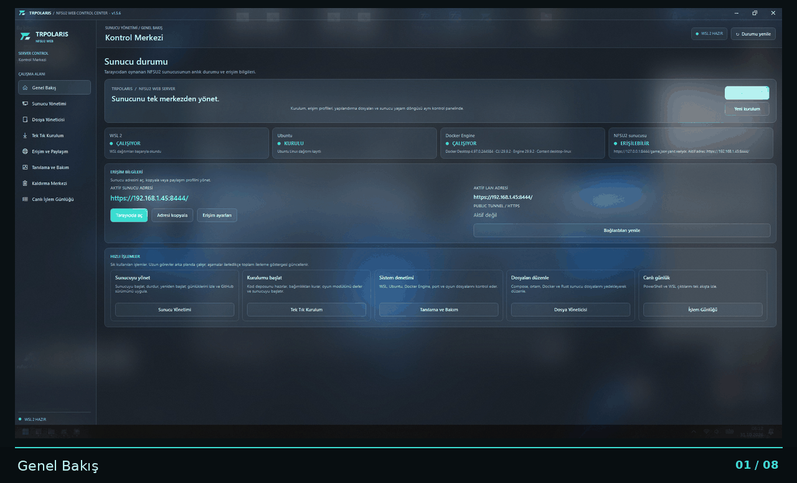
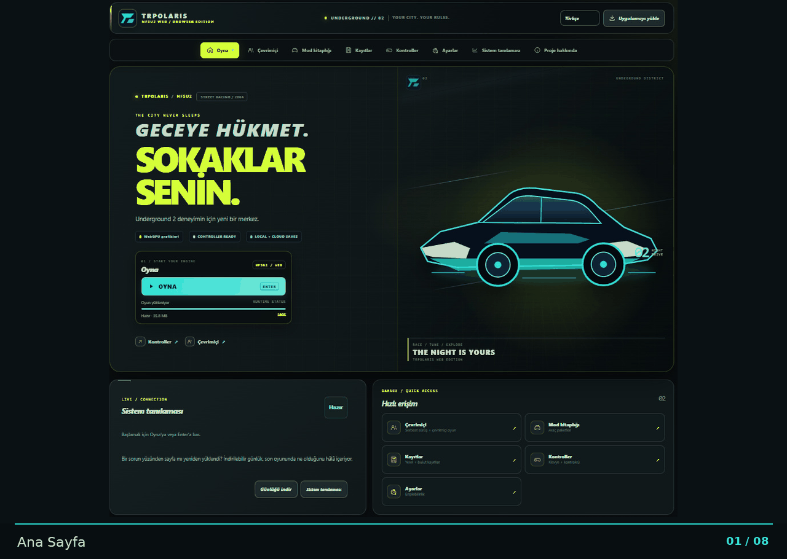

# 🏁 TRPOLARIS · NFSU2 Web

**Need for Speed: Underground 2 deneyimini modern web teknolojileriyle tarayıcıya taşıyan topluluk projesi.**

[Proje](#proje-hakkında) · [Ekran Görüntüleri](#ekran-görüntüleri) · [Control Center](#trpolaris-control-center) · [NFSU2 Web](#nfsu2-web) · [Kurulum](#kurulum) · [Geliştirme](#geliştirme) · [Lisans](#lisans-ve-atıflar)

---

## Proje hakkında

**TRPOLARIS NFSU2 Web**, Need for Speed: Underground 2 deneyimini WebAssembly, WebGPU ve modern web teknolojileriyle tarayıcıya taşımayı amaçlayan bağımsız bir topluluk projesidir. Web istemcisi, Rust tabanlı sunucu ve Windows yönetim uygulaması aynı depoda yer alır; ancak ayrı kaynak alanları ve bağımsız derleme süreçleriyle geliştirilir.

### Esin kaynağı ve proje atfı

Projenin temel teknik esin kaynağı, [th0mk/nfsu2-web](https://github.com/th0mk/nfsu2-web) açık kaynak projesidir. TRPOLARIS çalışması, bu projenin ortaya koyduğu tarayıcı tabanlı NFSU2 yaklaşımından ilham alır ve bunun üzerine kendi kullanıcı arayüzünü, sunucu yönetimi ve dağıtım akışlarını, ağ tanılama geliştirmelerini ve Windows Control Center uygulamasını ekler.

Orijinal proje ve katkıları kendi geliştiricilerine aittir. Bu depodaki TRPOLARIS'e özgü geliştirmeler ayrı yürütülür; orijinal projenin geliştiricileri tarafından hazırlanmış veya onaylanmış olarak sunulmaz.

> [!IMPORTANT]
> Bu depo Need for Speed: Underground 2 oyun dosyalarını içermez. SPEED2.EXE, server.dll, oyun arşivleri ve telifli oyun verileri dağıtılmaz. Kullanım ve derleme için kendi yasal PC oyun kopyanız gerekir.

## İki bağımsız uygulama

| Uygulama | Platform | Görevi |
|---|---|---|
| **NFSU2 Web** | Web tarayıcısı / Linux sunucu | Oyunu tarayıcıda çalıştırır; Local, LAN ve çok oyunculu deneyimi sunar. |
| **TRPOLARIS Control Center** | Windows / WPF / .NET 10 | WSL, Ubuntu ve Docker üzerinden NFSU2 Web kurulumunu ve sunucu yönetimini kolaylaştırır. |

Control Center web oyununun parçası değildir. İki uygulama aynı depoda bulunsa da kaynak kodları, CI süreçleri ve sürüm etiketleri birbirinden bağımsızdır.

---

## Ekran görüntüleri

Uygulama ekranlarını otomatik kayan galerilerde inceleyebilir, tablolardaki bağlantılardan tam boy görselleri açabilirsiniz.

### TRPOLARIS Control Center

  

| Ekran | Açıklama |
|---|---|
| [01 · Genel Bakış](docs/screenshots/control-center/01-genel-bakis.jpg) | WSL, Ubuntu, Docker ve sunucu durumu. |
| [02 · Sunucu Yönetimi](docs/screenshots/control-center/02-sunucu-yonetimi.jpg) | Container işlemleri, güncelleme ve günlükler. |
| [03 · Dosya Yöneticisi](docs/screenshots/control-center/03-dosya-yoneticisi.jpg) | WSL proje dosyalarını görüntüleme ve düzenleme. |
| [04 · Tek Tık Kurulum](docs/screenshots/control-center/04-tek-tik-kurulum.jpg) | Oyun klasörü ve port seçimiyle kurulum. |
| [05 · Erişim ve Paylaşım](docs/screenshots/control-center/05-erisim-ve-paylasim.jpg) | Local, LAN / HTTPS ve Public Tunnel profilleri. |
| [06 · Tanılama ve Bakım](docs/screenshots/control-center/06-tanilama-ve-bakim.jpg) | WSL, Docker, port ve sunucu kontrolleri. |
| [07 · Kaldırma Merkezi](docs/screenshots/control-center/07-kaldirma-merkezi.jpg) | NFSU2 bileşenlerini seçerek kaldırma. |
| [08 · Canlı İşlem Günlüğü](docs/screenshots/control-center/08-canli-islem-gunlugu.jpg) | PowerShell ve WSL işlemlerini canlı izleme. |

### NFSU2 Web

  

| Ekran | Açıklama |
|---|---|
| [09 · Ana Sayfa](docs/screenshots/web/09-ana-sayfa.jpg) | Oyunu başlatma ve hızlı erişim alanları. |
| [10 · Çevrimiçi](docs/screenshots/web/10-cevrimici.jpg) | Oyuncular, ekipler, konvoy ve çevrimiçi tercihler. |
| [11 · Mod Kitaplığı](docs/screenshots/web/11-mod-kitapligi.jpg) | Community Picks ve kişisel mod listesi. |
| [12 · Kayıtlar](docs/screenshots/web/12-kayitlar.jpg) | Yerel kayıtlar, yedekleme ve bulut kayıtları. |
| [13 · Kontroller](docs/screenshots/web/13-kontroller.jpg) | Klavye ve oyun kumandası eşlemeleri. |
| [14 · Ayarlar](docs/screenshots/web/14-ayarlar.jpg) | Oyun, arayüz ve erişilebilirlik tercihleri. |
| [15 · Sistem Tanılaması](docs/screenshots/web/15-sistem-tanilamasi.jpg) | Tarayıcı, WebGPU, sürüm ve oyun verisi kontrolleri. |
| [16 · Proje Hakkında](docs/screenshots/web/16-proje-hakkinda.jpg) | Proje bilgisi, kaynak kodu ve bildirimler. |

---

## TRPOLARIS Control Center

Control Center, NFSU2 Web'i Windows üzerinden kurmak ve yönetmek için hazırlanmış bağımsız bir masaüstü uygulamasıdır. WSL 2, Ubuntu ve Docker işlemlerini tek arayüzde toplar.

### Özellikler

- Tek tıkla kurulum, bağımlılık hazırlığı ve WebAssembly üretim akışı.
- NFSU2 sunucusunu başlatma, durdurma, yeniden başlatma ve sağlık kontrolü.
- WSL proje dosyalarını görüntüleme ve düzenleme.
- Local, LAN / HTTPS ve isteğe bağlı Cloudflare Tunnel erişim profilleri.
- WSL, Ubuntu, Docker Engine, port ve sunucu tanılaması.
- Canlı işlem günlükleri ve ilerleme görünümü.
- NFSU2 kaynaklarına yönelik seçmeli kaldırma işlemleri.

### Gereksinimler

- Windows 10/11, x64.
- WSL 2 ve Ubuntu dağıtımı.
- Çalışır durumda Docker Engine (Docker Desktop veya uygun WSL Docker kurulumu).
- Kurulum dosyalarını ve bağımlılıkları indirmek için internet bağlantısı.
- WebAssembly üretimi için uyumlu, kullanıcıya ait NFSU2 PC oyun kopyası.

### İndirme ve kurulum

**[Control Center sürümleri ve indirmeler](https://github.com/trpolaris/NFSU2-Web/releases)** · [Kaynak kodu](control-center/) · [Ayrıntılı kullanım rehberi](control-center/README.md)

1. Releases sayfasından yayımlanmış Windows sürümünü indirin.
2. WSL 2, Ubuntu ve Docker Engine durumunu kontrol edin.
3. Control Center'ı açın ve **Tek Tık Kurulum** ekranına geçin.
4. SPEED2.EXE içeren kendi oyun klasörünüzü seçin; HTTP portunu ve erişim profilini belirleyin.
5. Kurulumu başlatın ve işlem günlüğünden adımları takip edin.
6. Sunucu container'ının sağlık durumu **healthy** olduktan sonra Local veya LAN adresini tarayıcıda açın.

Varsayılan yapılandırmada proje kökü C:\nfsu2, yerel HTTP portu 9093 ve LAN HTTPS portu 8443'tür. Etkin ayarlar uygulama içinden kontrol edilmelidir.

Windows günlükleri: **%LOCALAPPDATA%\TRPOLARIS\NFSU2-Web-Control-Center\logs**

> [!CAUTION]
> Kaldırma öncesinde oyun kayıtlarını ve önemli dosyaları yedekleyin. Ubuntu WSL dağıtımını kaldırmak içindeki tüm Linux dosyalarını siler. Docker Desktop'ı kaldırmak diğer Docker projelerini etkileyebilir. Oyun klasörünü veya state volume'unu silmek kullanıcı verilerinin kaybolmasına neden olabilir. Yalnızca kaldırmak istediğiniz NFSU2 bileşenlerini seçin.

Public Tunnel tek başına kimlik doğrulaması sağlamaz. İnternete açık kullanımda Cloudflare Access veya eşdeğer bir erişim kontrolü yapılandırın.

---

## NFSU2 Web

Web istemcisi, kullanıcının kendi oyun kopyasından üretilen WebAssembly modülünü tarayıcıda çalıştırır. Rust sunucusu web dosyalarını ve oyun verilerini sunar; WebSocket üzerinden LAN ve çok oyunculu bağlantıları yönetir.

### Öne çıkan özellikler

- WebAssembly çalışma zamanı, WebGPU grafikleri ve Web Audio ses sistemi.
- Klavye, fare, uyumlu oyun kumandası ve desteklenen dokunmatik girişler.
- Local, sanal LAN, Free Roam ve Online bağlantı akışları.
- Yerel kayıtlar ve desteklenen sunucu kurulumlarında bulut kayıtları.
- PWA ve önbelleğe alınmış verilerle sınırlı çevrimdışı kullanım.
- Çok dilli arayüz, mod kitaplığı ve oyun içi ayarlar.
- F8 üzerinden FPS ve ağ tanılama metrikleri.

### Tarayıcı ve oyun dosyası

Güncel Google Chrome önerilir. WebGPU desteği tarayıcıya, işletim sistemine, GPU'ya ve sürücülere bağlıdır. Başka cihazlardan erişim için HTTPS gerekir; localhost yerel geliştirme için uygundur.

Proje belgelerinde hedeflenen PC sürümü **Need for Speed: Underground 2 v1.2 North America** olarak belirtilir.

| Dosya | Beklenen değer |
|---|---|
| SPEED2.EXE | 4.800.512 bayt |
| SHA-256 | f9dd86c054878ce6276beb07c1fd61874f7a1e4bf1f241b084c65b73e24168a7 |

Oyun dosyaları depoda bulunmaz ve uygulama tarafından indirilmez. server.dll dosyanız varsa SPEED2.EXE ile aynı oyun klasöründe bulundurun.

F8 ekranındaki RTT, oyuncular arası doğrudan ping değildir; istemci ile sanal LAN sunucusu arasındaki WebSocket gidiş-dönüş süresini gösterir. Ayrıntılar için [Ağ Tanılama Rehberi](docs/web/NETWORK-DIAGNOSTICS.md) sayfasına bakın.

---

## Kurulum

### Control Center ile

Windows'ta önerilen yöntem Control Center kullanmaktır. Yukarıdaki kurulum adımlarını ve [Control Center README](control-center/README.md) dosyasını izleyin.

### Linux / WSL üzerinden manuel kurulum

Manuel derleme için Ubuntu veya WSL 2 ortamında Git, Python 3, Node.js 24, Rust stable, C/C++ derleme araçları ve WASI SDK 34 gereklidir.

1. Depoyu klonlayın: **https://github.com/trpolaris/NFSU2-Web**
2. Python bağımlılıklarını requirements.txt üzerinden kurun.
3. WASI SDK 34'ü depo kökündeki deps dizinine yerleştirin.
4. Kendi oyun kopyanızın SPEED2.EXE dosyasıyla web/gen.sh çalıştırın.
5. WebAssembly modülünü web/build.sh ile derleyin.
6. web/start.sh ile yerel sunucuyu başlatın.

Varsayılan yerel adres: **http://localhost:8080**

Ayrıntılı adımlar için [VPS ve kurulum rehberi](docs/web/VPS.md) ve [Oynama Rehberi](docs/web/PLAYING.md) dosyalarını inceleyin.

### VPS ve Docker

NFSU2 Web, Linux VPS üzerinde Docker Compose ile yayımlanabilir. Varsayılan yapılandırma web/deploy/compose.yml içindedir. Oyun verileri ve WebAssembly modülü Docker imajından ayrı bağlanır; kalıcı sunucu verileri ayrı bir volume'da tutulur.

DNS, dosya aktarımı, TLS, Cloudflare ve güvenlik ayarları için [VPS kurulum rehberini](docs/web/VPS.md) izleyin. İnternete açmadan önce sunucu erişim politikasını yapılandırın; varsayılan kurulum uygulama seviyesinde kullanıcı hesabı veya parola zorunluluğu getirmez.

---

## Geliştirme

### Depo yapısı

| Yol | İçerik |
|---|---|
| app/, runtime/ | Uygulama varsayılanları ve oyun çalışma zamanı. |
| web/ | Tarayıcı arayüzü, Rust sunucusu, dağıtım ve web testleri. |
| tools/, win/ | Geliştirme araçları ve Windows yardımcı bileşenleri. |
| control-center/ | Bağımsız WPF / .NET 10 masaüstü uygulaması. |
| docs/web/ | Oynama, VPS, ağ tanılama ve mimari belgeleri. |
| docs/screenshots/ | README ekran görüntüleri ve galeriler. |
| .github/workflows/ | Web CI ve container image iş akışları. |

### Web kontrolleri

Web arayüzünü doğrulamak ve derlemek için web klasöründe npm ci, npm run check ve npm run build komutlarını çalıştırın. Rust sunucusu için web/server-rs/build.sh ve testler için web/server-rs/build.sh --test kullanılabilir.

### Control Center derlemesi ve sürümleme

Control Center, Windows üzerinde .NET 10 ile web uygulamasından bağımsız derlenir. Sürümleri control-center-vX.Y.Z etiketiyle yayımlanır. Windows Release derlemesi, tek dosyalı EXE, SHA-256 doğrulaması ve temiz kurulum testleri tamamlanmadan bir sürüm doğrulanmış kabul edilmemelidir.

Ayrıntılar: [Control Center geliştirme rehberi](control-center/README.md).

### Teknik dokümantasyon

- [Oynama Rehberi](docs/web/PLAYING.md)
- [VPS Kurulumu](docs/web/VPS.md)
- [Ağ Tanılama](docs/web/NETWORK-DIAGNOSTICS.md)
- [Tasarım ve Mimari](docs/web/DESIGN.md)
- [Control Center Rehberi](control-center/README.md)
- [Rust Sunucu Rehberi](web/server-rs/README.md)

---

## Lisans ve atıflar

Kaynak kodunun lisans koşulları için [LICENSE](LICENSE) dosyasını inceleyin. Bu lisans Need for Speed: Underground 2 oyununu veya Electronic Arts'a ait oyun varlıklarını kapsamaz.

Need for Speed ve Need for Speed: Underground 2, Electronic Arts'ın ticari markalarıdır. **TRPOLARIS, Electronic Arts ile bağlantılı değildir; EA tarafından desteklenmez veya onaylanmaz.**

Teknik esin kaynağı: [th0mk/nfsu2-web](https://github.com/th0mk/nfsu2-web). Orijinal projenin kaynak kodu ve katkıları kendi sahiplerine aittir. TRPOLARIS'e ait ek arayüz, yönetim, dağıtım ve entegrasyon çalışmaları bu depoda ayrı olarak geliştirilir.

---

**TRPOLARIS**  
*Underground 2 · Your city, your rules.*

[⬆ README'nin başına dön](#-trpolaris--nfsu2-web)

